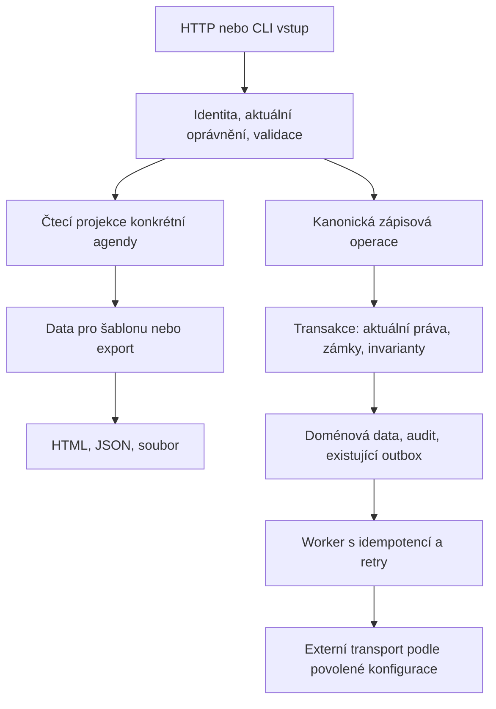

# Komplexní plán refaktoringu a optimalizace Evidence / KIS

**Stav k 30. 10. 2026: W6–W15 implementovány, CI PASS, sloučeno a nasazeno po ověřené obnově DB kapacity. Viz [technické uzavření](REFACTORING_CLOSURE_2026-10-30.md) a [release důkaz](verification/db-temp-recovery-20261030/RESULTS.md).**
Průběžné zápisy níže zachycují historii plánu; aktuální stav určuje tento úvod a CURRENT_STATE.
Vlastník 30. 10. výslovně zadal autonomní pokračování všemi zbývajícími vlnami
až do technického dokončení, včetně sloučení a nasazení po úspěšném ověření.
Není nutné nové potvrzení každé vlny. Provozní aktivace integrací, převody
skutečných dat a lidská přejímka zůstávají samostatná rozhodnutí.
Zadání vlastníka z 29. 10. 2026: připravit komplexní pojetí celé aplikace,
v dalších krocích autonomně implementovat. Navazující pokyn vlastníka aktivoval
[první realizační balík](REFACTORING_K0_W6_2026-10-29.md). Původní příprava
plánu měnila pouze dokumentaci; realizace navazuje na dokončené vlny 1–5.

Výchozí zdroj `49daae3a192d8168ed427c7adb4f203c916081d9`, ověřený fetch 29. 10.
Pracovní větev `codex/comprehensive-refactoring-plan-20261029`, izolované worktree
`C:/Users/Marek/Documents/Codex/evidencePavel-comprehensive-refactoring-plan-20261029`.
Původní checkout s rozpracovaným `kis_rosters_admin.php` zůstává nedotčený.
Aktuální release a provozní hranice patří do [CURRENT_STATE](CURRENT_STATE.md),
pravidla převzetí do [HANDOFF_CURRENT](HANDOFF_CURRENT.md).

## 1. Cíl a měřítko úspěchu

Zrychlit důležité uživatelské cesty, zmenšit cenu bezpečných změn a zpřehlednit
odpovědnost kódu při zachování současných doménových pravidel. Každá změna má
měřitelný výkonový přínos, doložené odstranění vady, nebo konkrétní zlepšení
udržovatelnosti ověřené stejným chováním. Počet přepsaných řádků není výsledek.

Zachovat PHP/PDO modulární monolit, existující URL, kanonické writery, aktéry,
transakce a vlastnictví dat. Nový framework, mikroservisy, globální ORM,
persistentní cache oprávnění, plošný redesign ani upgrade platformy nejsou
výchozí prostředek tohoto plánu. Případný takový návrh musí nejprve doložit
problém, alternativy, provozní náklady a kompatibilitu.

Technické dokončení znamená, že všechny níže uvedené oblasti byly prověřeny,
každý přijatý balík má důkazy a nezavádí regresi a každý vyřazený kandidát má
zdůvodnění. Neznamená účetní převzetí, vyřešení skutečných osob ani aktivaci služeb.

## 2. Ověřený základ a nejistoty

[Inventura zdrojů](verification/comprehensive-refactoring-plan-20261029/source-inventory.json)
nad uvedeným SHA: 2 102 trackovaných souborů; 610 PHP souborů aplikace/CLI
(106 892 řádků, včetně legacy souborů), 160 unit a 159 integračních testovacích
souborů, 43 MariaDB podpůrných skriptů, 28 HTTP acceptance skriptů a 140 PHP migrací.
Definici výběru obsahuje [reprodukční skript](verification/comprehensive-refactoring-plan-20261029/inventory-source.py).
Nejde o počet aktivních endpointů, výkonnostní profil ani procento testového pokrytí.

Načtená metadata a nadpisy všech 238 trackovaných Markdown dokumentů jsou v
[inventáři dokumentace](verification/comprehensive-refactoring-plan-20261029/documentation-inventory.json).
Podrobně byly posouzeny aktuální stav, pravidla práce, poslední refaktoringové
protokoly, mapa datových toků, nálezy, kvalita PHP, předání implementace R01–R44
a provozní rozhodnutí. Nejde o novou ruční revizi každého řádku aplikace ani
o nový audit obsahu PDF/XLSX/DOCX příloh.

| Doložené zjištění | Dopad na plán |
| --- | --- |
| Vlny 1–5 jsou dokončené; poslední technický release `a14d1026` je doložen 28. 10. | Zachovat dosažené rozpočty: cílený detail a navigace, programové karty 120 SQL při 50 programech. Neimplementovat hotové balíky znovu. |
| Přesný main má úspěšné Testy, PHP quality, CodeQL a Current documentation; při kontrole nebyl otevřený PR. | Novou etapu vždy znovu založit z aktuálního main, zkontrolovat mezitím vzniklé PR/WIP. |
| Poslední release prošel 1 782 testy / 35 866 assertions, oběma MariaDB a 22/22 HTTP kontrolami před/po. | Výchozí důkaz, nikoli automatický PASS budoucí změny nebo úplné UAT. |
| PHPStan level 5 má 519 položek baseline / 2 407 výskytů. | Snižovat podle dotčené domény a skutečného nálezu; nepřidávat automaticky nové výjimky. |
| `shop_checkout.php` má 2 182 řádků, `club_program.php` 1 825; velké jsou i formuláře, synchronizace, plánovač a hlavička. | Kandidáti pro rozdělení odpovědností. Délka sama není důkaz pomalosti nebo vady. Minifikované soubory naopak mohou délku podhodnocovat. |
| Starší F01/F02/F10 uváděly přímé e-maily v requestech; současná registrace/reset/rezervace používají fronty. Textové hledání nachází čtyři `mail()` volání v transportních funkcích. | Neplánovat plošnou náhradu hotových front. Prověřit skutečné volající, retry a provozní důkazy; samotný výskyt `mail()` není chyba. |
| Starší dokumentace tvrdí, že Fio nemá schedule; současný workflow má plán pod přepínačem. | Kód a aktuální flags mají přednost. Opravovat aktivní návody cíleně, historické důkazy zachovat. |

V tomto plánovacím kroku nebyla spuštěna nová produkční diagnostika ani měněna
produkce. Provozní údaje jsou poslední doložený stav z 28. 10.; před vydáním
je povinné nové čtení. Dosud neznáme výkonové profily všech přihlášených agend,
produkční distribuci velikostí dat ani provozní doručení všech druhů zpráv.

## 3. Cílové uspořádání uvnitř monolitu

- Vstupní stránka řeší request, guard, CSRF a odpověď; doménové rozhodnutí volá.
- Čtecí projekce vrací přesně potřebná data, umí stránkování/dávku a nevytváří DDL.
  Kontext čtení žije v jediné operaci a na jediném PDO. Není autoritou pro zápis.
- Zápis zůstává u kanonické služby. Opakuje aktuální oprávnění a podmínky uvnitř
  transakce, zachovává pořadí zámků, idempotenci a audit. Refaktoring nesmí
  přesunout bezpečnostní kontrolu před čekání na zámek a tím ji oslabit.
- Prezentace nesmí spouštět skryté SQL nebo transport. Formátovací helper může
  sdílet zobrazení; nesmí sjednotit odlišné účetní nebo autorizační významy.
- Základní typy (ID, peníze, časové hranice, stavy) zpřesňovat nejprve PHPDoc
  a validací vstupů; malé datové objekty zavádět jen tam, kde omezí konkrétní chyby.
- Existující fasády a názvy funkcí ponechat jako kompatibilní vstupy při postupné
  extrakci. Odstranit je až po inventuře všech volajících a behaviorálním důkazu.

## 4. Rozsah celé aplikace a invarianta

| Oblast a hlavní zdroje | Kritické toky a co musí zůstat pravda |
| --- | --- |
| Bootstrap, session, role: `includes/init.php`, `auth_session.php`, `session_security.php`, `staff_workspaces.php`, `coach_scope.php` | Přihlášení → aktivní pracovní pozice → konkrétní rozsah → akce. Revokace je účinná při dalším chráněném rozhodnutí, namespace trenéra/zákazníka/sportovce se nemísí; negativní průchody 401/403/redirect bez těla. |
| Osoby, rodiny, členství: `family_portal.php`, `account_person_role.php`, `account_person_claim.php`, `sportovec_karta.php` | Účet ≠ osoba ≠ plátce ≠ členství. Platnost vazeb a souhlasů, karanténa sporných identit, verzování a audit; žádné odhadované párování skutečných osob. |
| Programy a katalog: `club_program.php`, `club_program_read_context.php`, `shop_storefront_read.php`, `shop_catalog_cards.php` | Zveřejnění → prodejnost → příjemce → kapacita → podmínky. Sdílené fyzické týmy, termíny, placené čekání na identitu, expirace a překrytí období musí mít stejné výsledky. |
| Sport, soupisky, kalendáře: `kis_roster.php`, `training_closure.php`, `sports_activity.php`, `race_results.php`, `club_calendar.php`, `planovac.php` | Plán → RSVP → skutečná účast → uzavření → historie/náhrada. Plán není skutečnost, uzavřená historie se nepřepisuje; trenér vidí jen svěřený rozsah. |
| Zdravotní způsobilost a osobní dokumenty: `medical_clearance.php`, `medical_activity.php`, soukromé downloady | Platnost posudku a omezení činnosti, oprávněný příjemce, verze podkladu a dohled. Citlivé údaje se nesmějí objevit v obecné cache, exportu cizí role nebo diagnostickém logu. |
| Rezervace a veřejné akce: `club_event_registration.php`, `public_velodrome.php`, `venue_operations.php`, stránky individuálních lekcí | Kapacita, souběh, čekací listina, deadline storna, přihlášení a platba. Žádný oversell ani dvojí povýšení čekajícího. |
| Obchod a sklad: `shop_checkout.php`, `shop_inventory.php`, `shop_fulfillment.php`, `shop_returns.php` | Serverový přepočet → rezervace → objednávka → úhrada → výdej → vratka. Neověřená zásoba není neomezená; ceny a slevy nejsou autoritou klienta; idempotence a platná skladová bilance. |
| Finance a účetnictví: `accounting_ledger.php`, `accounting_documents.php`, `accounting_export.php`, `member_charge_read.php`, `club_finance.php`, `financial_decisions.php` | Předpis, pohyb peněz, alokace, doklad, zákaznický stav a expedice jsou rozdílné skutečnosti. Zachovat částky, VS, řady, historické snapshoty a uzavřené období; opravy jsou auditované, ne tichý přepis. |
| Komunikace a integrace: `auth_mail_outbox.php`, `club_event_notification.php`, `roster_message.php`, `family_weekly_delivery.php`, worker CLI a poskytovatelé | Doménová změna + outbox atomicky; claim/retry/expirace, ochrana tokenů, stav zařazeno/odesláno/doručeno. Refaktoring nesmí zvýšit počet reálných odeslání ani zapnout provider. |
| Importy, soubory a exporty: `sync_evidence.php`, KIS review/import helpery, `private_storage.php`, `bin/db-backup.php` | Náhled → explicitní mapy → fingerprint → promote → dohled. Idempotence, soukromé soubory, staging/finalize/kompenzace, kontrolní součty a obnova; bez automatického převodu skutečných dat. |
| UI, navigace, API a provoz: `hlavicka.php`, `ui_shell.php`, `assets/app-ui.*`, admin/booking vstupy, workflow | Zachovat URL, role, návratový kontext, české popisky, escaping, přístupnost a mobilní chování. Testy a CLI nesmějí být veřejným vstupem. |

Názvy bez adresáře v tabulce označují helpery v `includes/`, pokud není uvedeno jinak.
První [registr 16 hlavních cest](REFACTORING_ROUTE_REGISTER_2026-10-29.md) doplnilo K0.1;
detailní audit vlastníků a endpointů pokračuje po doménách. Tato tabulka není úplný
seznam cest ani nový návrh vlastnictví historických tabulek.

## 5. Etapy a pořadí

Etapa je několik malých PR, ne jeden rozsáhlý přepis. Základní pořadí:
**K0 → W6 → W7 → W8 → W9 → W10 → W11 → W12 → W13 → W14 → W15**.
Průřezové testy, dokumentace a zúžení baseline se provádějí v každém balíku;
W14 je závěrečná systematická konsolidace, ne odklad testování.
Reprodukovaná chyba ztráty dat, překročení práv nebo nesprávné finanční operace
má před výkonovou frontou přednost a dostane vlastní opravný PR.

| Vlna | Přijatá realizace a důkaz | Dispozice dalších kandidátů |
| --- | --- | --- |
| W6 | [Kapacity a migrované schéma](REFACTORING_W63_2026-10-29.md), čistá projekce, omezená materializace. | Zámky a deduplikace zachovány; žádný nový framework ani globální cache. |
| W7 | [Celý rodinný přehled](REFACTORING_W72_2026-10-29.md), [metadata](REFACTORING_W73_2026-10-30.md), [členská pole](REFACTORING_W74_2026-10-30.md), [registrář](REFACTORING_W75_2026-10-30.md). | R04 finanční historie byla přesunuta do W10; nové autorizační čtení při zápisu se nezkracuje cache. |
| W8 | [Timeline](REFACTORING_W76_W81_2026-10-30.md), [filtry](REFACTORING_W82_2026-10-30.md), [kopírování/ICS](REFACTORING_W83_2026-10-30.md), [kalendář](REFACTORING_W84_2026-10-30.md), [rezervace/docházka/zdravotní souběhy](REFACTORING_W85_2026-10-30.md). | Transakční guardy a historické revize zůstávají doménově oddělené. |
| W9 | [Celá skladová stránka](REFACTORING_W9_2026-10-30.md), [košík a skladové souběhy](REFACTORING_W92_2026-10-30.md). | Ceny, VS, kapacity a zámky se počítají kanonicky; žádná plošná přestavba checkout writeru. |
| W10 | [Indexované projekce](REFACTORING_W10_2026-10-30.md), [100k XLSX](REFACTORING_W102_2026-10-30.md), [klubová salda](REFACTORING_W103_2026-10-30.md), [ledger metadata](REFACTORING_W104_2026-10-30.md). | PDF není streamované; celý ZIP má oddělený objemový důkaz W12. Snapshot, částky a pořadí jsou zachovány. |
| W11 | [Claim/retry/crash](REFACTORING_W11_2026-10-30.md), [cílená kontrola příjemce](REFACTORING_W112_2026-10-30.md). | Nesjednocovat doménové payloady. Neznámý výsledek odeslání se drží pro kontrolu; nepředstírat exactly-once externí doručení. |
| W12 | [Parser, index preview, exportní snapshot a úplná obnova](REFACTORING_W12_2026-10-30.md). | Bez změny identity matching pravidel, reálných importů a aktivace providerů; velký součin kandidátů a libovolně velký PDF nemají nový SLA. |
| W13 | [Sdílené UI a formulářové labely](REFACTORING_W13_2026-10-30.md), čtyři role × desktop/mobil v Chromiu. | Shell byl sjednocen již dříve; další přesuny šablon a mazání assetů bez doloženého přínosu se neprovádějí. |
| W14 | [Brána PHPStan baseline](REFACTORING_W14_2026-10-30.md), negativní detekce a přenosné fixtures. | Zachováno 515 položek / 2350 legacy nálezů. Technická etapa není tvrzení o nulovém dluhu nebo úplném přepsání aplikace. |
| W15 | [Propojená technická přejímka](verification/refactoring-w15-20261030/RESULTS.md), invarianty a finální provozní evidence. | Lidské/účetní UAT, skutečná ocenění, identity, přílohy a aktivace integrací zůstávají oddělené. |

Podle K0 se pořadí výkonových kandidátů může změnit: nejprve častá a pomalá cesta
s doloženou příčinou a zvládnutelným rizikem. Neodkládat ochranu dat kvůli snadnému
výkonovému výsledku. Přesuny etap zapsat s důvodem; neprohlašovat neprověřený
balík za dokončený. Kalendářní odhady až po K0 a prvním ověřeném řezu domény.

## 6. První proveditelný balík: K0 + W6.1

1. Čerstvý main, vlastní worktree, aktuální CI/PR a protokol základní verze.
2. Založit registr cest alespoň pro: veřejný katalog/detail; rodinný přehled
   a osoby; registrářský seznam/kartu; trenérský plánovač/účast; kalendář a
   rezervaci; objednávku; skladový pohyb; ledger/doklad/export; frontu;
   preview importu a zálohu. Uvést roli, scope, tabulky, citlivé údaje a testy.
3. Pro každou cestu změřit SQL, přenesené řádky, čas PHP/HTTP, špičkovou paměť
   a velikost odpovědi. Zápisy měřit pouze na syntetické DB s blokovanými transporty.
   Navržené velikosti: seznamy osob 100/1 000/10 000, kalendář 1/12/52 týdnů,
   ledger/export 1 000/10 000/100 000 řádků; obsahuje i neaktivní a nepřístupné
   záznamy. K0 ověří proveditelnost na testovacím hostu a rozpočty upraví před
   měřením. Nejde o tvrzení o skutečných produkčních objemech.
4. W6: znovu profilovat `clubProgramOfferCapacityStateForTeam()` a volající.
   Rozlišit čas jednotlivých SQL, počet vrácených řádků a PHP deduplikaci.
5. Uložit charakterizační testy níže. Teprve poté vybrat nejmenší výhodnou
   změnu: sdílené čisté vyhodnocení, omezené přednačtení nebo doložený index.
   Jedna nová obří SQL není automaticky lepší než více malých indexových lookupů.
6. Vydat samostatný PR s měřením a testy; pokud žádná bezpečná optimalizace
   nevyjde, doložit důvod, zachovat kanonickou cestu a pokračovat nejvýše
   hodnoceným kandidátem z K0. Nenutit změnu kvůli číslu vlny.

### Povinné scénáře W6

- Nula/jedna/více nabídek, 1/10/50/400/401 variant; více variant stejného
  programu a několik programů na jednom či více fyzických týmech.
- Překryv období, stejné mezní datum, neplatné/chybějící datum a původní fallback.
  Čas vyhodnocovat v původní zóně Europe/Prague, včetně změny letního času.
- Aktivní přihlášky téhož sportovce přes více nabídek se počítají stejně jako dnes.
- Nezaplacená objednávka před/přesně v/po expiraci; placená rychlá registrace
  čekající na identitu; zamítnutá/zrušená žádost; již aktivovaná položka.
- Deduplicita podle osoby/žádosti/položky a původní pravidlo quantity; nevydávat
  jednoduchý COUNT(*) za ekvivalent existujícího výpočtu.
- Kapacita NULL/0/kladná, více týmů s odlišným obsazením, legacy chybějící sloupce,
  `excludeHeldSportovecId` a nové čtení po změně rezervace či přihlášky.
- Dvě spojení soutěžící o poslední místo, rollback, opakovaný checkout a změna
  oprávnění během čekání. Žádná recyklace veřejného kontextu při FOR UPDATE.

## 7. Měření a pravidla přijetí

| Co | Protokol / brána |
| --- | --- |
| Správnost | Před změnou charakterizovat platné chování; pro opravu vady reprodukovat selhání. Porovnat úplné struktury, typy, pořadí a relevantní chyby. Golden výstupy nesmějí jen kopírovat novou implementaci. |
| SQL | Malý/běžný/zátěžový syntetický dataset, stejné schema a data před/po; počet dotazů i řádků, EXPLAIN na MariaDB 10.3/11.4. Index navrhnout až po důkazu plánu, zhodnotit cenu zápisů a DDL. |
| Latence | Oddělit čas služby, celé HTTP a browser. Minimálně 5 zahřátí + 30 střídavých měření na klidném testovacím prostředí, uložit vzorky/medián; p95 označit za hrubý odhad při malém vzorku. Neprovádět produkční zátěž bez samostatného zadání. |
| Paměť a velikost | Zaznamenat peak memory, načtené řádky a velikost odpovědi/exportu. Dávkové čtení nesmí neomezeně načíst historii celé aplikace. Parametrické limity musí být testované. |
| Nejasný výsledek | Při nečekaném zpomalení nad 10 % nebo růstu paměti nad 20 % zopakovat řízeně, určit příčinu a rozhodnutí doložit. Jde o spouštěč šetření, nikoli toleranci bezpečnostní či účetní regrese. |
| Přínos refaktoringu | Popsat odstraněnou duplicitu, zmenšenou odpovědnost, zpřesněný kontrakt nebo konkrétní odstraněný nález. Neslibovat výkon bez měření; některý bezpečný refaktoring může být výkonově neutrální. |
| Bezpečnost a souběh | Negativní role, cizí ID, CSRF, odnětí vztahu, aktuální scope, reálné DB zámky a idempotence. SQLite je rychlá regrese, ne důkaz MySQL zamykání nebo kolace. |
| UI a dokumenty | Při změně šablon skutečný browser desktop/mobil, klávesnice a chybové stavy. PDF/XLSX změny ověřit obsahem i renderem; binární hash může měnit metadata, porovnává se i doménový význam. |

Pro K0 se nepředepisuje plošný SLA ani nereálný cílový počet SQL pro všechny
agendy. Konkrétní rozpočet se uloží před implementací z naměřené příčiny.
U W6 je výchozí 120 SQL při 50 programech; přesný cíl určí W6.1 podle řádků,
indexů, fan-out týmů a paměti. Správnost a zachování zámků mají absolutní přednost.

## 8. Testy a existující nástroje

Znovu použít existující testy, ne zavádět paralelní druhou testovací infrastrukturu:

- Programy: `ProgramOfferBatchReadTest`, `ProgramTermsBatchReadTest`,
  `ProgramStorefrontReadCompatibilityTest`, `ClubProgramSharedCapacityTest`,
  `ClubProgramPaidIdentityCapacityTest`, `ClubProgramPaymentLifecycleTest`.
- Osoby/role: `AccountPersonRoleTest`, `AccountPersonClaimTest`, `FamilyPortalTest`,
  `AuthSessionValidationTest`; MariaDB autorizační race skripty pro dotčenou doménu.
- Sport/obchod: `SportsActivityTest`, `RaceResultsTest`, `ShopInventoryTest`,
  `ShopReturnsTest`; existující HTTP a MariaDB race skripty pro uzavření, výdej a vratky.
- Finance: `AccountingLedgerTest`, `AccountingDocumentsTest`, `AccountingExportTest`,
  `AccountingStockExportTest`; konzistentní snímky exportů a kontrakty ochrany VS.
- Komunikace: `AuthMailOutboxTest`, `TransactionalNotificationWorkerTest`,
  `OperationalDeliveryMariaDbRace.php`; transport pouze lokální/syntetický.

Před sloučením aplikační změny: Composer validate/audit, cílené regrese,
plný PHPUnit, MariaDB 10.3/11.4, PHPStan level 5 a jeho negativní kontrakt,
styl změněných PHP, anonymous sweep, JS kontroly, aktuální dokumentace a diff check.
POSIX/symlink bránu dokládá Linux bez skipů; Windows skip není úplný PASS.
Před deployem zkontrolovat také přesný sloučený main včetně CodeQL.
Čistě dokumentační plán se ověřuje odkazy/archivními kontrakty a jeho CI,
ne novým produkčním obchodním scénářem.

## 9. Autonomní realizační cyklus a změny schématu

1. Navazující implementační pokyn aktivuje K0 + W6.1. Před dalšími balíky číst
   tento plán, CURRENT_STATE, poslední protokol, aktuální main a otevřené PR.
   Platná oprávnění z konverzace se nepoptávají znovu; kontroluje se jejich rozsah.
2. Vlastní větev `codex/…`, jeden srozumitelný balík a explicitní seznam cest.
   Nezahrnovat cizí WIP, konfiguraci, klíče, dumpy ani skutečné osobní údaje.
3. Uložit plán řezu: problém, důkaz, vstupní rozpočet, invarianty, dotčené role,
   tabulky, testy, rollback a definici hotovo. Potom test → změna → ověření.
4. Před merge zkontrolovat celý diff a finální head CI, nikoli starší zelený SHA.
   Sloučení a nasazení provést v rozsahu platného zadání; příprava tohoto plánu
   sama neprovádí žádné nové aplikační vydání.
5. Produkční deploy jen existujícím chráněným workflow: ověřená záloha před
   aktivací, migrační check, zachování VS, HTTP a nový čtecí protokol před/po.
   Kódový release má `importovat_krouzky=false`, `uat_schvaleno=false`, dokud
   není skutečně zvlášť doložené plné UAT daného commitu.
6. Nová migrace pouze při prokázané potřebě, jako nový neměnný soubor. Odhadnout
   DDL zámky/dobu, použít aditivní kompatibilitu, otestovat upgrade i opakování.
   Nová vlastněná tabulka doplní backup ownership kontrakt. Žádné DDL v requestu.
7. Návrat rozlišuje kód a data: návrat předchozího kódu jen při kompatibilním
   schématu. Obnova zálohy není automatická reakce na chybu, mohla by ztratit
   nové transakce; připravit konkrétní dopřednou opravu nebo řízený návrat.
   Hosting stále používá rsync bez delete, nikoli doložený atomický symlink swap.
8. Po vydání uložit PR/SHA/CI/deploy, vzorky a výsledky; aktualizovat CURRENT_STATE,
   celý starý přehled archivovat s hashem. Samostatně sledovat implementaci,
   testy, merge, nasazení a lidskou přejímku. Ukončit jednu dohodnutou vlnu,
   nezačínat bez hranice neomezený řetězec dalších změn.

Při zahájení a dokončení etapy aktualizovat také stav tohoto plánu a stručný
odkaz v HANDOFF_CURRENT; nenechat po implementaci tvrzení „ještě nezačala“.

Když se prokáže regrese, neobcházet kontrolu ani nezvětšovat baseline. Opravit
reprodukovaný problém nebo z balíku změnu vyřadit. Když nelze pokračovat bez
reálné identity, účetní metodiky, provozního okna či souhlasu s novou aktivací,
zapsat přesný otevřený bod a pokračovat jiným nezávislým povoleným balíkem.

## 10. Mimo automatickou implementaci

Refaktoring nezapíná Fio/auto-confirm/SumUp/Stripe/Velocota/Packetu, nemění
frekvenci skutečných rozesílek, nepřevádí živé osoby a salda a nevypíná staré
služby. Stav každého poskytovatele a workeru znovu ověřit; neoznačovat všechny
transporty za vypnuté jen proto, že jsou vypnuté platební integrace.

[D01–D20](CLUB_COMPLETION_DECISIONS.md) a [pilot D12–D14](CLUB_PILOT_D12_D14.md)
nadále drží skutečné inventury/ocenění, rodinné vazby, trenérské rozsahy,
finanční dohody, převzetí účetní a dvě chybějící přílohy. Refaktoring může
zlepšit diagnostiku a zpracování, nesmí tyto skutečnosti doplnit odhadem.

## 11. Historické průběžné zápisy realizace

Následující tabulka a dodatky zachovávají stav při dokončení jednotlivých
vln. Formulace o tehdy otevřených navazujících vlnách nejsou aktuální backlog.
Konečné rozhodnutí pro všechny oblasti shrnuje
[technické uzavření](REFACTORING_CLOSURE_2026-10-30.md); živé vydání a zbývající
provozní převzetí určuje [CURRENT_STATE](CURRENT_STATE.md).

| Položka | Stav k 29. 10. 2026 | Další výstup |
| --- | --- | --- |
| Vlny 1–5 | Dokončené a doložené | Zachovat regresní rozpočty a chování |
| Komplexní plán | Sloučený v PR #219; realizace autorizována | Průběžná aktualizace podle důkazů |
| K0 + W6.1 | První balík sloučen v PR #220 po úspěšném CI | Migrovaný profil doplnilo W6.3; K0.2 ostatních agend otevřené |
| W6.2 | [Čistá extrakce](REFACTORING_WAVE6_2026-10-29.md) sloučena a nasazena; [důkazy](verification/refactoring-wave6-release-20261029/RESULTS.md) | Hotovo; zachovat nové kontrakty |
| W6.3 | [Paměť kapacit](REFACTORING_W63_2026-10-29.md) sloučena a nasazena; [důkazy](verification/refactoring-w63-release-20261029/RESULTS.md) | Hotovo; dávkové sdílení mezi nabídkami zůstává samostatný kandidát, navazuje K0.2/W7 |
| W7.1a | [Cílený rodinný přístup](REFACTORING_W71_2026-10-29.md) sloučen a nasazen; [důkazy](verification/refactoring-w71-release-20261029/RESULTS.md) | Hotovo; souběhovou autorizaci následně řeší W7.1b |
| W7.1b | [Souběhová autorizace](REFACTORING_W71B_2026-10-29.md) sloučena v PR #227 a nasazena; [důkazy](verification/refactoring-w71b-release-20261029/RESULTS.md) | Hotovo pro RSVP, rezervaci a storno; plný profil R02 následně doplnilo W7.2 |
| W7.2 | [Celý rodinný přehled](REFACTORING_W72_2026-10-29.md), PR #229, nasazeno; [důkazy](verification/refactoring-w72-release-20261029/RESULTS.md) | Hotovo; 20 osob SQL 2706 → 2326, řádky 2953 → 2193, shodná data/HTML, čerstvá autorizace |
| W7.3 | [Metadata a sekce](REFACTORING_W73_2026-10-30.md), PR #231, nasazeno 30. 10.; [důkazy](verification/refactoring-w73-release-20261030/RESULTS.md) | Hotovo; GET 20 osob SQL 2244 → 752, metadata 1590 → 98. Shodná data/HTML, nemetadata SQL a historie; POST bez cache |
| W7.4 | [Dávkové členství](REFACTORING_W74_2026-10-30.md), PR #233 nasazeno; [důkazy](verification/refactoring-w74-release-20261030/RESULTS.md) | Hotovo; 20 osob 752 → 619 SQL, členství 160 → 27; shodná data/HTML/řádky, čerstvá autorizace |
| W7.5 | [Registrář](REFACTORING_W75_2026-10-30.md), PR #235 nasazeno; [důkazy](verification/refactoring-w75-release-20261030/RESULTS.md) | Hotovo pro stránkování; 10 003 → 53 řádků, paměť stránky 100 z 36,8 na 0,43 MB; zbývající R03/R04 v W7.6 |
| Zbytek W7 a W8–W15 | Naplánované, další měření otevřené | Malé PR podle závislostí a skutečných výsledků K0 |
| W7.6 / W8.1 | [Osobní čtení a časová osa](REFACTORING_W76_W81_2026-10-30.md), PR #237 nasazeno; [důkazy](verification/refactoring-w81-release-20261030/RESULTS.md) | Hotovo v daném rozsahu; roční profil 4176 → 16 SQL, shodná data; finanční historie předána W10 |
| W8.2 | [Sportovní filtry a kopírovací náhled](REFACTORING_W82_2026-10-30.md), PR #238 nasazeno; [release](verification/refactoring-w82-release-20261030/RESULTS.md) | Roční filtr 1875 → 5 SQL, nižší paměť, shodná data; hotovo v daném rozsahu |
| Lidské/účetní převzetí, aktivace a ostré převody | Otevřené podle konkrétních rozhodnutí | Samostatné podklady a provozní přejímka |

[W8.3 — rodinný kalendář](REFACTORING_W83_2026-10-30.md), PR #240, je
[nasazen společně s W8.2](verification/refactoring-w82-release-20261030/RESULTS.md):
roční feed 4199 → 39 SQL, shodná historie/ICS a nižší paměť.
Další části W8 a W9–W15 zůstávají otevřené.

[W8.5 — sportovní kontrakty](REFACTORING_W85_2026-10-30.md) doplňuje
skutečné souběhy rezervačního controlleru a přenositelné testy uzavření,
náhrad a zdravotních rozhodnutí do obou CI MariaDB. [Měření](verification/refactoring-w85-20261030/RESULTS.md)
zachovává potřebné transakční zámky; browser přejímka pokračuje W13/W15.

Každý balík povede protokol `docs/verification/<balik>/RESULTS.md` s: základním
SHA, hypotézou a měřením, změnou, přesnými příkazy/fixtures, výsledkem před/po,
omezeními, souběžnými testy, CI finálního headu, release identitou, případným
rollbackem a dalším krokem. Zjištění má status **ověřeno / kandidát / neplatí
na současném main / čeká na rozhodnutí**, nikoli neurčité „hotovo“.

### Podklady pro příští implementaci

[Protokol přípravy a omezení](verification/comprehensive-refactoring-plan-20261029/RESULTS.md).

[CLAUDE](../CLAUDE.md), [stav](CURRENT_STATE.md), [převzetí](HANDOFF_CURRENT.md),
[dokumentační základ](REFACTORING_DOCUMENTATION_2026-10-28.md),
[pátá vlna](REFACTORING_WAVE5_2026-10-28.md),
[poslední release](verification/refactoring-wave5-release-20261028/RESULTS.md),
[kvalita PHP](PHP_QUALITY.md), [F1–F3](DOZOR_F1_F3_2026-10-26.md),
[předání R01–R44](CLUB_IMPLEMENTATION_HANDOFF.md),
[datové toky](../outputs/data-flow-audit-2026-10-07/DATOVE_TOKY_KOD.md),
[historické nálezy 19. 10.](../outputs/data-flow-audit-2026-10-19/NALEZY_A_RIZIKA.md),
[identitní outbox](identity-email-queue.md), [nasazení](NASAZENI.md),
[migrace](../migrations/README.md).

## Průběžná W8.4 — klubový kalendář

[Plán](REFACTORING_W84_2026-10-30.md) a
[měření](verification/refactoring-w84-20261030/RESULTS.md): dávkové přílohy
povolených akcí a vozidel, roční staff seznam 2913 → 9 SQL. PR #241 je
[nasazen a ověřen](verification/refactoring-w84-release-20261030/RESULTS.md).
Autorizace a writeři zachováni. [Navazující kontrakty W8.5](verification/refactoring-w84-20261030/SPORT_FOLLOWUP.md)
zůstávají otevřené; celý plán W9–W15 tím není uzavřen.

## Průběžná W9.1 — skladový přehled

[Plán W9](REFACTORING_W9_2026-10-30.md) a
[měření skladu](verification/refactoring-w91-20261030/RESULTS.md): celý výpis
10 000 variant 20008 → 34 SQL, shodné HTML i data, dávky nejvýše 400 zůstatků.
Košík, checkout a navazující W10–W15 zůstávají otevřené.

W9.1 je [nasazena a produkčně ověřena](verification/refactoring-w91-release-20261030/RESULTS.md),
včetně již sloučených testovacích kontraktů W8.5. UAT zůstává samostatné.

[W9.2](REFACTORING_W92_2026-10-30.md) a
[protokol](verification/refactoring-w92-20261030/RESULTS.md) doplňují
programový košík (členský 1862 → 275 SQL, shodná data) a přenosné skutečné
skladové race. Profily čtení získávají samostatný CI job jako časnější část W14;
cross-offer kapacita je posouzena a ponechává per-offer čtení bez sdílení se zápisy.

## Průběžná W10.1 — finanční řádky exportu

[Plán W10](REFACTORING_W10_2026-10-30.md) a
[měření](verification/refactoring-w10-20261030/RESULTS.md): čisté indexované
projekce nahrazují kvadratické průchody, zachovávají snapshot i celý XLSX.
Úplná serializace, historie/ledger a další části W10–W15 ještě navazují.

[W10.2](REFACTORING_W102_2026-10-30.md) řeší doložené překročení paměti celé
serializace XLSX. [Měření](verification/refactoring-w102-20261030/RESULTS.md)
ověřuje 100 000 pohybů pod 256 MiB při zachování hodnot, typů a formátování.
W10.3 navazuje finančními projekcemi klubu, historií a ledgerem; W11–W15 otevřené.

W9.2 / W10.1 jsou [nasazené a ověřené](verification/refactoring-w92-release-20261030/RESULTS.md).
[W10.3](REFACTORING_W103_2026-10-30.md) indexuje klubové finanční projekce
a měří ledger/osobní historii. Nález 2204 SQL pro 200 čekajících zdrojů
má samostatný [plán W10.4](REFACTORING_W104_2026-10-30.md).

W10.2 je [nasazená a ověřená](verification/refactoring-w102-release-20261030/RESULTS.md).

[W10.4](REFACTORING_W104_2026-10-30.md) odděluje čtecí orchestrace zdrojů:
2204 → 1207 SQL, metadata 1002 → 5, stejné výsledky a čerstvé write kontroly.
Po přijetí a nasazení navazuje [W11](REFACTORING_W11_2026-10-30.md);
úplné technické scénáře/obnova a browser přejímka zůstávají W12–W15.
