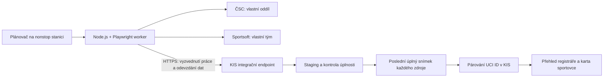

# P15 — Čtecí synchronizace ČSC a Sportsoftu do KIS

Datum: 7. 11. 2026, Europe/Prague. Vlastník: Marek / klub; realizace: vývoj KIS.
Stav: **S0 ČÁSTEČNĚ HOTOVO; kontrakt a předání stanici hotové, cílová inventura otevřená**.
Zvolený rozsah: čtení obou portálů, párování UCI ID, worker na nonstop stanici.
[Registr P15](WORK_PLAN_CURRENT.md), [rozhodnutí D2026-11-07-P15](DECISION_LOG.md#d2026-11-07-p15),
[průzkum a ověření](verification/csc-sportsoft-discovery-20261107/RESULTS.md).

Větev: `codex/csc-sportsoft-read-sync-plan-20261107`.
Worktree: `C:/Users/Marek/Documents/Codex/evidencePavel-csc-sportsoft-plan-20261107`.
Základ inspekce kódu: `8e9cdce1ef758529dfa5a9950424518d39a79dc6`.
Předání: větev publikována, [PR #371](https://github.com/KovoPraha/evidenceTreninku/pull/371) otevřené; merge/deploy/aktivace NOT RUN.
Navazující zadání vlastníka: provést S0 a průběžně zapsat inventuru a seznam polí.
Stanice je jiný Windows počítač s Rikim; KIS má být provozně oddělený.
Podrobnosti: [kontrakt S0](CSC_SPORTSOFT_S0_CONTRACT_V1.md),
[stanice](CSC_SPORTSOFT_S0_STATION.md), [předávací prompt](verification/csc-sportsoft-s0-20261107/STATION_PROMPT.md).
Portály se nemění; S1 implementace/testy hotové, aktivace NOT RUN.
Navazující [S4 čtecí přehled](CSC_SPORTSOFT_S4_REGISTRAR.md) rozpracován podle zadání vlastníka.

## 1. Zadání, hranice a rozhodnutí

Vlastník vybral první etapu: čtecí synchronizaci ČSC a Sportsoftu, párování
přes UCI ID a provoz automatizace na nonstop stanici. Prohlížeč byl pro průzkum
přihlášen ručně. Zadání nepovoluje nové přihlášky, licence, platby ani změny
údajů na portálech. Podrobná technická řešení níže jsou implementační návrh.

„Čtecí“ znamená **bez zápisů do ČSC/Sportsoftu**. Aby KIS ukazoval poslední
ověřený stav, bude ukládat nové integrační snímky, vazby a audit do své DB.
Nebude automaticky měnit `sportovci`, zakládat osoby, členství, účetní platby,
rodinné vazby ani účast na závodech. První skutečný přenos do produkční DB KIS
a zapnutí pravidelného běhu mají samostatný, přesně vymezený provozní krok.

První verze zahrne:
- ČSC: pouze přehled licencí vlastního oddílu, všechny jeho stránky, stav,
  rok platnosti, disciplínu, kategorii, roli, hostování, ID licence a UCI ID.
- Sportsoft: pouze členy vlastního týmu; seznam závodů a již existující
  přihlášky jen pro správcem vybraný seznam závodů, jejich kategorie a údaj
  „zaplaceno“. Úhrada zde je externí pozorování, nikoli účetní zápis KIS.
- KIS: porovnání, přísné párování UCI ID, frontu nejasností, stáří dat,
  správu běhů a provozní stav stanice.

Mimo první verzi: vytváření přihlášek/členů/licencí, jejich změny a storna,
žádosti, platby, hostování/přestupy, import výsledků, fotografie a přílohy.
Výsledky a export ČSC jsou zjištěné návaznosti, nikoli další povinná etapa P15.
Omezení na vlastní oddíl/tým se ověří před každým čtením; neskenovat celý svaz.

## 2. Ověřený základ a napojení na současný KIS

| Existující zdroj | Zjištění a použití |
| --- | --- |
| [Editor sportovce](../includes/sportovec_editor.php) | `sportovci.uciid` existuje; editor připouští text do 80 znaků. Nelze předpokládat čistá, unikátní jedenáctimístná ID. Kanonický editor zůstane jedinou dosavadní cestou opravy karty. |
| [Importní párovač](../includes/kis_match_lib.php) | `kisMatchResolve()` může automaticky spojit i jméno + datum narození či KIS external ID. Pro P15 jej nepoužít jako automatický resolver; nový striktní resolver nemění chování starých importů. |
| [Import osob](../includes/kis_person_import.php) a [jeho migrace](../migrations/20261020180000_kis_full_person_import.php) | Existují profily/kontakty/importní vazby. P15 nejde přes importní apply/promotion a neobnovuje odložený P06. |
| [Pracovní pozice](../includes/staff_workspaces.php) | Správa osob patří registráři. Nová stránka dostane explicitního vlastníka `registrar` a vlastní actor funkci; robot nebude lidský administrátor. |
| [Historie sportovce](../includes/sportovec_history_lib.php) | Navázat audit pouze při ručním rozhodnutí; nestahovat celou osobní kartu do auditního payloadu. |
| [Privátní úložiště](../includes/private_storage.php), [migrace](../migrations/README.md) | Použít projektové uložení mimo webroot, migrace přes CLI, doplnit backup ownership kontrakt a obnovu nových tabulek. |
| [Časování členství](../includes/monthly_membership_scheduler.php) | Příklad zámku/stavu, nikoli místo pro nový worker. P15 má vlastní frontu a plán stanice; finanční crony zůstanou oddělené. |

Konkrétní nové názvy níže jsou návrhy, ne tvrzení o existujících souborech.
Před implementací znovu načíst aktuální main a ověřit migrace/kontrakty.

## 3. Architektura první verze



KIS PHP/MySQL zůstává zdrojem klubových osob a vlastní frontu, validaci,
párování, oprávnění a přehled. Stanice běží pod vyhrazeným OS účtem, má
samostatné browser profily obou portálů a pouze odchozí HTTPS spojení.
Nepotřebuje veřejný port, přístup k DB ani obecné vzdálené spouštění příkazů.

Worker bude verzovaný Node.js/TypeScript proces s uzamčenými závislostmi
Playwright a oddělenými adaptéry. Nepoběží jako smyčka příkazů do Codexu.
Po upřesnění S0 se Riki/Nanoclaw nepoužije ani pro dohled. KIS má vlastní
Windows účet, proces, profily, plánovač a stav v KIS; žádné sdílení soukromých dat.
Budoucí přesun stejného procesu na server je možný po samostatném ověření;
v této etapě nic dalšího neprovisionovat.

## 4. Sběr, který nezmění portály

### ČSC

1. Otevřít uloženou ověřenou cestu oddílu, ověřit přihlášení a identitu oddílu.
2. Počkat na záhlaví a řádky tabulky, ne jen URL nebo `load`.
3. Přečíst seznam licencí stránku po stránce s pevným pořadím; zaznamenat
   zobrazený celkový počet, stránku, počet řádků a unikátní externí ID.
4. Sběr omezit na seznam. V první verzi neotvírat editační dialogy a nestahovat
   rodná čísla, adresy, kontakty, fotky, smlouvy ani odkazy/tokeny digitálních karet.
5. Uložit rok platnosti a příznak platnosti přesně podle zdroje. Neodvozovat
   platnou licenci jen z roku a neodvozovat z licence členství v KIS.
6. Více licencí stejného člověka zachovat; UCI ID není klíčem jedné licence.

### Sportsoft

1. Ověřit přihlášený tým. Přečíst `/private/team.aspx`, včetně role a
   `source=api/manual`; jde o jiný rozsah než všechny licence ČSC.
2. Přečíst přehled závodů a u nakonfigurovaných závodů pouze existující
   „Prohlédnout / změnit přihlášku“. Neexistující přihlášku nezakládat.
3. Přečíst UCI ID, kategorii a stav platby z existující přihlášky. Nezaškrtávat
   výběr účastníka/platby a nepoužít „Uhradit startovné“.
4. ID závodu převzít z pozorované cesty/mapy; nehádat podle pořadí tlačítka,
   data nebo podobného názvu. Význam parametru `m` dosud není ověřen.
5. Překontrolovat schéma stránky a očekávaná záhlaví po každém postbacku.

Oba adaptéry mají seznam povolených navigačních akcí a zakázané zápisové
ovladače. Prosté blokování všech POST není možné: Sportsoft je používá i
pro navigaci; Blazor může čtecí interakce posílat po živém spojení.
Bezpečnost proto musí vycházet z konkrétní ověřené akce, ne HTTP metody.
Neočekávaná stránka, dialog nebo změna struktury znamená `layout_changed`
a ukončení sběru bez náhradního AI klikání. Neobcházet CAPTCHA, 2FA nebo omezení.

Jeden běh má jeden browser writer/čtenář pro daný profil; ruční přihlášení
zamkne automatické kroky. Výchozí návrh zatížení: sekvenční navigace,
minimálně 2 s mezi stránkami, respektovat 429/Retry-After a ukončit při 403.

## 5. Datový kontrakt a DB návrh

Předběžné tabulky (číselnou migraci přidělit až při realizaci):
- `external_sync_connections`: provider, pevný oddíl/tým, enabled,
  interval, povolené kolekce/závody, poslední úspěch, revize konfigurace.
- `external_sync_devices`: station ID, hash náhodného bearer tokenu,
  povolená connection ID, revokace a heartbeat; bez hesel/cookies portálů.
- `external_sync_runs`: run UUID, connection, kolekce/rozsah, sekvence,
  lease generation, stav, časy serveru, verze adaptéru/schématu, počty a hash.
- `external_sync_parts`: run, pořadí části, hash, allowlistovaný JSON a
  validace; unikátní (run, part). Příjem dílu ještě nezpřístupní nový snímek.
- `external_sync_records`: run, provider, scope, druh a externí klíč,
  UCI ID jako řetězec, minimální zobrazovací údaje a typovaná externí pole.
- `external_identity_links`: provider + scope + entity key, sportovec_id,
  UCI při rozhodnutí, metoda, revize, status a autor. Licence mohou ukazovat
  na stejnou osobu; jeden externí záznam nesmí mít dvě aktivní vazby.
- `external_sync_reviews`: typ nejasnosti, záznam, kandidáti jako ID,
  rozhodnutí/důvod, actor a čas. Oddělit audit stroje od lidského registráře.

Kolekce `csc_licenses`, `sportsoft_members`, `sportsoft_events` a
`sportsoft_registrations` s rozsahem `event_id` mají vlastní úplnost i poslední
úspěšný snímek. Chyba jedné přihlášky nezneplatní kompletní seznam členů.
ČSC klíč = externí ID licence v rozsahu oddílu. U Sportsoftu teprve ověřit
ID řádku; není-li k dispozici, použít deklarovaný složený klíč
(scope, UCI, role) či (event, UCI, category) a kolize zablokovat.
Externí platba = `paid/unpaid/unknown` plus doslovný stav zdroje,
nikdy nová položka `payments`.

Přesná pole a validační pravidla nyní vlastní [kontrakt S0](CSC_SPORTSOFT_S0_CONTRACT_V1.md)
a [JSON Schema](verification/csc-sportsoft-s0-20261107/contract.schema.json).
Zkrácená ilustrace obálky (placeholdery nejsou platný produkční payload):
```json
{
  "schema_version": 1,
  "run_id": "<uuid>",
  "connection_id": "<server-issued-id>",
  "lease_generation": 1,
  "collection": "csc_licenses",
  "event_id": null,
  "scope_id": "<verified-club>",
  "part_no": 1,
  "adapter_version": "<release>",
  "observed_at": "<UTC timestamp>",
  "rows": [],
  "page": {"index": 1, "reported_total": 0, "row_offset": 0, "row_count": 0}
}
```

Jde o popis formátu, nikoli platný prázdný produkční import.
Závěr obsahuje počet dílů/stránek, součet řádků, unikátní klíče a celkový hash.
Server ověří JSON schema, rozsah connection/lease, časy, limity (návrh
250 řádků a 1 MiB na díl), známá pole a referenční integritu.
Neznámá pole včetně rodného čísla/adresy odmítnout; neukládat obecné HTML.

Publikace snímku a posun ukazatele `latest_complete_run` proběhnou
v jedné transakci až po serverové validaci všech dílů. Stejný díl se stejným
hashem je bezpečné opakování; stejný klíč s jiným hashem je konflikt.
Starší sekvence nebo odvolaná lease nesmí přepsat novější úspěch.
Pokud se zdroj mění během stránkování (počty/duplicitní ID/pořadí), běh
zopakovat jednou od začátku; při další neshodě `incomplete`.

Nenalezený řádek není smazaná osoba: po úplném běhu lze označit `not_seen`,
ale historii a vazbu nesmazat. Nulový výsledek nebo pokles přes 20 % proti
poslednímu běhu je `review_required`; nepublikovat automaticky. První
produkční baseline musí registrář porovnat se skutečnými tabulkami.
Počet 254/130 z průzkumu není natvrdo zakódovaná podmínka.

## 6. Jednoznačné párování UCI ID

Nová čistá služba `includes/external_identity_match.php`; nepřepisovat
obecný `kisMatchResolve()`. Párování běží na serveru nad aktuálními daty KIS.
Stanice proto nepotřebuje stáhnout celý adresář sportovců KIS.

Normalizace: řetězec, odstranit pouze ASCII space a NBSP podle kontraktu S0,
pak přesně 11 ASCII číslic. Zachovat úvodní nuly, nepřevádět na číslo,
neodstraňovat písmena/interpunkci. Formát není důkaz přidělení ID; checksum
nezavádět bez samostatně ověřeného pravidla. `uciid` kanonické karty neměnit.

| Situace | Výsledek |
| --- | --- |
| Jedno validní UCI a právě jeden sportovec KIS; bez konfliktní existující vazby | `matched`, vytvořit jen integrační vazbu s proveniencí |
| Chybí UCI | `missing_uci`, ruční fronta; žádné spojení jménem |
| Vadný formát | `invalid_uci`, zachovat diagnostiku, bez automatické opravy |
| Stejné UCI u dvou sportovců KIS | `duplicate_kis_uci`, nikomu automaticky nepřiřadit |
| Validní UCI bez sportovce KIS | `unmatched`, nezaložit osobu |
| Existující vazba vede k jinému UCI/osobě; nebo se změnilo UCI karty | `identity_conflict`, před dalším zobrazením vazbu suspendovat |
| Více různých licencí ČSC se stejným UCI | Legitimní 1:N; zachovat všechny licence |
| Stejné UCI má rozporné osobní údaje; nebo nesouhlasí dostupné datum narození | `identity_conflict`; jméno/datum je kontrola rozporu, nikoli náhradní klíč |

Porovnání jmen toleruje velikost písmen, diakritiku a mezery; ostatní
neshody předává registráři. Datum narození se kontroluje jen pokud je
v minimálním zdrojovém přehledu; kvůli němu neotvírat citlivý editor ČSC.
Více stejných členů/rolí ve Sportsoftu seskupit, konfliktní duplicity zachovat
k řešení. Vazby znovu posoudit po změně UCI či sloučení osob v KIS.
První verze neumožní ruční vynucené spojení dvou různých UCI.
Registrář může označit záznam „nespadá do KIS“, odložit jej nebo opravit kartu
stávajícím oprávněným postupem; po opravě resolver provede nové vyhodnocení.
Ruční rozhodnutí má očekávanou revizi, důvod a audit; zastaralý náhled odmítnout.

## 7. Konkrétní integrační hranice KIS

Navržené nové soubory:
- `includes/external_sync.php`, `external_sync_ingest.php`,
  `external_identity_match.php`, `external_sync_read.php`.
- `external_sync_admin.php`: registrářský přehled a ruční fronta.
- `api_external_sync.php`: pouze machine API, akce
  `claim/heartbeat/upload_part/complete/fail` (POST).
- `bin/external-sync-operations.php`: správa device/connection a retence
  přes oprávněný provozní CLI; žádné nové DDL z webu.
- `workers/external-sync/`: TypeScript adaptéry, validace, konfigurace,
  syntetické fixtures, instalační/runbook podklady stanice.
- `sportovec_karta.php`: čtecí panel „ČSC / Sportsoft“, pouze podle
  oprávnění registráře; připojit dávkově, nevytvářet N+1 dotazy.

Machine API: TLS, náhodný token pouze v Authorization header, server má
jeho hash a oprávnění na konkrétní connection/akce. Bez přihlášení lidským
účtem, bez cookie fallbacku, bez práv na obecné importy/karty/platby.
Auth vždy před vykonáním akce; neplatný/revokovaný token 401, chybný rozsah
403, konflikt lease/revize 409, limit 413. Rate limit a audit bez tokenu.
Bearer endpoint nepoužívá session CSRF; lidské akce mají běžný CSRF,
actor funkci a opětovnou kontrolu oprávnění v transakci.
Novou cestu zahrnout do AnonymousSweep včetně platných syntetických payloadů.

Úloha obsahuje jen povolený typ a ID předem nakonfigurovaného rozsahu.
Nepřijímat JavaScript, příkazy, CSS selektory ani libovolnou URL od KIS.
Čtené odkazy validovat na povolený HTTPS host a cestu; neotevírat externí
digitální průkazy. Server nevěří station-supplied sportovec_id a sám páruje.
V administraci nastavení/vypnutí workeru vyžaduje samostatnou provozní pravomoc;
registrář řeší záznamy, nemá automaticky přístup k tajemstvím zařízení.

## 8. Provoz nonstop stanice

Vlastník potvrdil jiný Windows počítač s Rikim; repozitář Rikiho dokládá
WSL2 Ubuntu a Docker, nikoli aktuální inventuru. Navržen je vlastní nativní
Windows worker mimo Riki/WSL/Docker. Místní Codex převezme [prompt S0](verification/csc-sportsoft-s0-20261107/STATION_PROMPT.md).
[Požadavky a hranice](CSC_SPORTSOFT_S0_STATION.md) vlastní konkrétní instalaci,
oddělení účtů, Node LTS, profily, boot a chybějící ověření. Zatím nic neinstalováno.

Návrh výchozího režimu po povolené aktivaci:
- Každých 6 hodin seznamy obou systémů; vybrané existující přihlášky jednou
  denně. Ruční „Obnovit“ jen zařadí deduplikovanou úlohu stejného typu.
- Heartbeat 60 s; po 5 minutách „stanice nedostupná“. Snímek starší 24 h
  označit „zastaralý“; ponechat čas posledního skutečného úspěchu.
- Lease 10 minut, obnovovat po minutě; po vypršení jiný proces může převzít
  úlohu, ale původní token generace už nic nepotvrdí.
- Síťové selhání: nejvýše 3 pokusy s odstupem 1/5/15 minut, pak chyba.
  Změna layoutu, autentizace a 403 se automaticky neopakují v těsné smyčce.
- Po restartu OS obnovit runner, prověřit relaci a navázat jen nepublikované
  díly aktuální lease, jinak začít nový běh. Ověřit i provoz při zamčené stanici.
- Headless režim je cílová varianta, zatím ověřen pouze headed průzkum.
  Jestli portal headless nepodporuje, nejdřív ověřit povolenou headed variantu.

Přihlášení ručně v dedikovaném profilu; při `auth_required` zastavit daný
adaptér, zobrazit obsluze přesnou doménu a po přihlášení znovu ověřit oddíl/tým.
Profily/relace nikdy nekopírovat z osobního Chromu. Cookies, hesla ani
storageState se neodesílají do KIS a nejsou součástí Gitu/zálohy aplikace.
Přístup jen OS účtu workeru, šifrovaný disk; po ztrátě profilu nové přihlášení.
Automatické zadávání hesel, obcházení 2FA/CAPTCHA a umělý keepalive nejsou V1.

Odpojená stanice může držet šifrovaný spool nejvýše 72 h; po potvrzeném
příjmu jej odstraní. Snímky v KIS návrhově 30 dní, minimální audit 180 dní;
poslední úplný stav ponechat se štítkem stáří. Retenci před aktivací potvrdí
vlastník dle klubových potřeb, včetně záloh a vyřazených osob. Žádný plošný
HTML dump/screenshot v pravidelném provozu. Diagnostika redigovaná, do Gitu
jen syntetické fixtures. Integraci lze zastavit flagem i revokací zařízení.
Po vypnutí zůstanou běžné funkce KIS i historické údaje funkční.

## 9. Etapy, výstupy a ověřitelná akceptace

| Etapa | Konkrétní výstup / závislost | Dokončeno, když |
| --- | --- | --- |
| S0 — kontrakt a inventura | ČÁSTEČNĚ: přesný kontrakt, syntetické podklady a prompt hotové; cílová inventura, Sportsoft scope/negativní platba a allowlist závodů zbývají | Schéma v1 a čtecí rozsah doložené; místní Codex předá obsahově omezenou inventuru bez přístupu k Rikimu |
| S1 — KIS úložiště a resolver | IMPLEMENTACE A SYNTETICKÉ OVĚŘENÍ HOTOVO v [draft #376](https://github.com/KovoPraha/evidenceTreninku/pull/376); [protokol](CSC_SPORTSOFT_S1_KIS.md), závisí na S0 #371 | Konflikty/idempotence/pořadí/rollback i obě MariaDB PASS; [důkazy a stav CI](verification/csc-sportsoft-s1-20261107/RESULTS.md). Merge/deploy/aktivace NOT RUN |
| S2 — čtecí adaptéry | Worker nejprve čte syntetické stránky; ČSC → Sportsoft členové → vybrané existující přihlášky | Úplnost stránek, změna DOM a expirovaný login testované; zápisové ovladače mají nulový počet použití |
| S3 — transport a provoz | Device token, scoped API, lease, restart, spool, dohled; závisí S1/S2 | Opakovaný přenos nevytvoří duplicitu; revoked device a stará lease odmítnuté; restart/lock/offline recovery PASS |
| S4 — přehled KIS ([čtecí řez rozpracován](CSC_SPORTSOFT_S4_REGISTRAR.md)) | Registrářský přehled, důvody nespárování, datum zdroje, read panel osoby; závisí S1/S3 | Neoprávněné role/rodiny data neuvidí; duplicitní UCI nelze potvrdit omylem; bez N+1 |
| S5 — schválený čtecí pilot | Nejdřív izolované prostředí, poté konkrétně povolený první produkční snímek | Registrář ověří baseline všech řádků, více licencí i absenci; druhý stejný běh bez duplicit a kanonických změn |
| S6 — pravidelný provoz | Aktivace vybraného plánu na stanici, runbook a předání | Sedm dní dohledaných běhů, kontrolovaný restart a jedno ruční obnovení relace; vlastník převezme stav a vypnutí |

S1/S2 lze vyvíjet nezávisle proti dohodnutému kontraktu, implementační PR
ale musí mít vlastní bezpečný rozsah. S5/S6 nejsou splněné samotným merge.
Časový odhad lze určit až po S0; neodhadovat nutnost AI podle absence API.

## 10. Testovací matice a podmínky prvního zapnutí

- UCI: validní řetězec, úvodní nula, mezery/NBSP, prázdné, písmena, špatná
  délka; dvě osoby KIS se stejným ID, změna UCI, odlišné datum/jméno,
  více licencí téže osoby, chybějící identita a konfliktní externí duplicity.
- Snímek: více stránek, stejné stránkování bez pokroku, chybějící poslední
  stránka, změna celkového počtu, prázdný výsledek, výpadek uprostřed,
  velký pokles, opakovaný díl, pozdní starší běh a neplatná kolekce/scope.
- Oprávnění: anonym, běžný trenér, rodinný účet, registrář, odvolaná pracovní
  pozice, platné zařízení, odvolané zařízení, jiný klub a zastaralá lease.
- UI: Blazor načtení/změna ID, ASP.NET postback, neočekávaný dialog, captcha,
  odhlášení během stránky; syntetická stránka zaznamená každý mutační handler
  a všechny musí mít nulu. Pouhé blokování POST není přijatelný test.
- Provoz: offline KIS/portál, 429, restart, zamčení OS, deduplikace scheduleru,
  šifrovaný spool, očištění logů a obnova integračních tabulek ze zálohy.
- Regrese: obecný importní párovač a karta sportovce zachovají původní chování;
  testy importu nemají být oslabeny novým striktním resolverem.

Před produkční aktivací doložit CI a přiměřené doménové/integrační/browser
testy, obnovu nové DB oblasti, revokaci zařízení, skutečný klubový scope,
úplný allowlist čtecích akcí a souhlas s retencí/intervalem/rozsahem pilotu.
Kontrola se týká reálné stanice; dnešní přihlášený Chrome není důkazem
bezobslužného provozu po restartu.

## 11. Další krok a předání

Další krok: předat [prompt místnímu Codexu](verification/csc-sportsoft-s0-20261107/STATION_PROMPT.md)
a získat cílovou inventuru/oddělení účtů. Kontrakt, schéma a syntetické fixtures
jsou připravené pro S1; jejich připravenost není dokončená inventura ani pilot.
Zatím nejsou nasazené endpointy, DB tabulky, worker, plánovač ani device token.
Nové přihlášky a licence jsou oddělená budoucí etapa vyžadující vlastní plán
a ověření přesného okamžiku zápisu na obou portálech.

Průzkum: PASS pouze v rozsahu [protokolu](verification/csc-sportsoft-discovery-20261107/RESULTS.md).
Dokumentační kontrola po převzetí main 2ef20aed PASS (4453 místních odkazů,
108 archivních bloků); git diff origin/main --check PASS. Předáno v PR #371.
Aktuální doplnění S0 a jeho kontrolu vede [protokol S0](verification/csc-sportsoft-s0-20261107/RESULTS.md).


## 12. S1 — zahájení serverové implementace 7. 11. 2026

Vlastník zadal implementovat úložiště, ingest a UCI matcher na syntetických
datech, bez nasazení nebo aktivace. Větev `codex/csc-sportsoft-s1-ingest-20261107`,
worktree `C:/Users/Marek/Documents/Codex/evidencePavel-csc-sportsoft-s1-20261107`.
Základ: S0 z PR #371 (dosud otevřené) + main 69f49033; S1 má vlastní PR.
Rozsah: číslovaná migrace a backup ownership, striktní validace v1, tokenová
autorizace zařízení, lease/idempotentní díly/atomický complete, samostatné
snímky/vazby/review. Kanonické tabulky se nemění. Machine API výchozí OFF.
Příprava explicitní baseline a přejímka poklesu dat nesmí být právem zařízení.
Serverové úložiště, ingest a UCI resolver jsou implementované a synteticky ověřené
v draft PR #376; runtime f61c365d, ověřený celek 2fe8aa93 (11 CI PASS).
S0 #371 nadále otevřené.
[Technický protokol S1](CSC_SPORTSOFT_S1_KIS.md) a
[průběžné výsledky](verification/csc-sportsoft-s1-20261107/RESULTS.md)
obsahují API pro druhé pracoviště, meze a stav testů. Žádná aktivace/deploy.

## 13. Předání S2/S3 cílovému Codexu

7. 11. 2026 vlastník zadal připravit konkrétní prompt pro syntetický vývoj
na nonstop stanici proti hotovému S1. [Prompt](CSC_SPORTSOFT_S2_S3_STATION_PROMPT.md)
je připravený a předává se dokumentačním doplněním draft PR #376 ve stejné
větvi `codex/csc-sportsoft-s1-ingest-20261107`. Neznamená spuštění S2/S3.

Zadání odděluje nové lokální testovací procesy od trvalé instalace: vlastní
worktree, profil/cache/spool, přesné loopback originy vytvořené harness,
žádný kontakt s Rikim nebo reálnými portály. Worker testuje skutečný S1
validator/ingest; výjimky kvůli HTTP/TLS se nepřidávají do produkčního API.
Výsledkem cílové stanice má být vlastní draft PR a sanitizovaný protokol,
nikoli aktivace účtu, scheduleru nebo pilotu. Stav cílového provedení NOT RUN.

Ověření předání: `php tools/check-current-docs.php` a `git diff --cached --check`
PASS; CURRENT 80 řádků, 4649 odkazů, 108 archivních bloků, 0 chyb.
Věcně porovnáno s aktuálním S1 protokolem a jeho testy; runtime se nemění.
