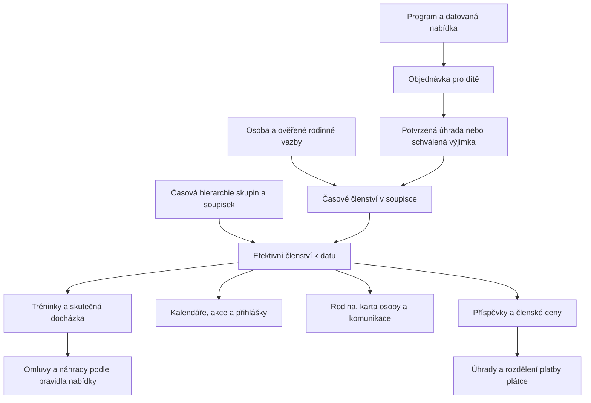

# Pracovní plán jednotné evidence členů bez sezon

Datum: 2. 11. 2026, Europe/Prague. Stav: **aplikační části E1–E5 a nástroj převodu E6 sloučeny v PR #279; produkční převod E7 a odstranění schématu E8 neprovedeny**. Přesný rozsah, přechodové závislosti a zbývající přejímky uvádí [implementační protokol](MEMBER_EVIDENCE_IMPLEMENTATION_2026-11-02.md).

Vlastník potvrdil cílový koncept: jedna karta osoby, trvalé skupiny a soupisky, časově platné členství, datované nabídky kroužků a společné využití členství v celé aplikaci. Historie před přechodem zůstane v původním KIS. Nový systém převezme potřebný výchozí stav a bude uchovávat vlastní provozní historii od přechodu.

Tento dokument je pracovní zdroj pro implementaci tohoto rozsahu. Nahrazuje požadavek uchovávat importovanou historii v novém systému a sezonní kompatibilitu jako cílový stav v [plánu z 20. 10.](ROSTER_GROUPS_TRAINING_SEASON_IMPLEMENTATION_PLAN_2026-10-20.md) a jeho [předání](ROSTER_HIERARCHY_IMPLEMENTATION_HANDOFF_2026-10-20.md). Tyto dokumenty zůstávají záznamem předchozího návrhu. Ostatní rozhodnutí a provozní stav aplikace tím nejsou přepsány.

Inventář níže vychází z načteného `origin/main` na commitu `2aa5cbd89040474074678c6a04cfb099cc8235a9`. Jde o kontrolu zdrojů, nikoli o audit aktuálních produkčních dat nebo potvrzení nasazení. Živé vydání a přepínače se ověřují podle [CURRENT_STATE](CURRENT_STATE.md) a skutečných workflow. Před každou etapou znovu porovnat změny od tohoto commitu.

## 1. Cílová pravidla

1. **Osoba:** `sportovci` zůstává kanonickou identitou. Rodičovské/uživatelské vazby a plátce jsou samostatné. Další kroužek, rok ani přestup nezakládá duplicitní osobu. Obecný stav osoby, sportovní zařazení, zaplacení a přístup k účtu se nesmějí zaměňovat.
2. **Skupina:** organizační celek, například Třebešín, Točná nebo Závodní tým. Členové se odvozují z podřízených soupisek platných k dotazovanému dni. Přímé nové členství ve skupině se nezakládá.
3. **Soupiska:** trvalá identita konkrétního kolektivu. Sportovec může být ve více soupiskách. Souhrny skupiny, příjemci zpráv a seznamy účastníků používají sjednocení osob bez duplicit.
4. **Zařazení:** platnost `od–do`, zdroj nároku, odkaz na zdroj, autor a důvod změny. Otevřený konec je přípustný pro průběžné oddílové členství; zakoupený kroužek má konec. Návrat vytváří nový interval. Přestup ukončí předchozí a založí nové zařazení k určenému dni.
5. **Čas:** datum aktivity určuje členství, hierarchii a viditelnost. Pro denní členské intervaly zachovat a dokumentovat inkluzivní konec; časové granty oprávnění mají vlastní kontrakt. Jedna společná funkce pro každou časovou doménu, žádné odlišné výklady mezi stránkami.
6. **Program a nabídka:** program a produkt kroužku jsou trvalé. Nabídka nese skutečné datum začátku/konce, cenu, kapacitu, prodejní okno a variantu období. Rok je odvozený filtr a popisek. Žádná nová technická náhradní sezona typu `KIS-STANDING` v cílovém modelu.
7. **Aktivace:** objednávka identifikuje dítě a přesnou nabídku. Potvrzená úhrada nebo výslovně evidovaná schválená výjimka aktivuje nárok; samotné založení objednávky členství neaktivuje. Opakování události nesmí založit další nárok.
8. **Docházka:** členství určuje očekávané účastníky a viditelnost. Skutečnost uzavírá trenér. Pozdější přestup nepřepisuje uzavřenou docházku, přihlášky ani finanční doklady.
9. **Příspěvky:** jeden předpis za osobu, plán a účtované období, i při více soupiskách. Plátce je výslovný; jedna platba může pokrýt více dětských závazků. Dluh je samostatný stav a sám nemaže členství.
10. **Historie:** předchozí provoz zůstane ve starém KIS. Vlastní historie nového systému od přechodu je potřebná pro přehledy, audit a návaznosti. Smazání importované historie nesmí vymazat používanou osobu, nový doklad nebo otevřený nárok.

## 2. Ověřený základ a konkrétní mezery

| Nález ve zdroji | Důsledek a požadovaná změna |
|---|---|
| `migrations/20261021090000_roster_hierarchy_temporal.php` již umožňuje `club_teams.season_id = NULL`, zavádí `team_kind`, `standing_code`, časové hrany a více členských intervalů. | Navázat na existující strukturu, nezavádět druhý model členů. Prověřit skutečné použití, unikátnost a souběh zápisů. |
| `includes/roster_hierarchy.php` vytváří trvalé skupiny/soupisky a vyhodnocuje členství k datu. | Zachovat jako základ společného výpočtu; doplnit chybějící operace a testy místo nové paralelní implementace. |
| `kis_rosters_admin.php` stále obsluhuje `create_season`, sezonní týmy a rollover. | Nestačí změnit titulek nebo skrýt tlačítko. Nahradit potřebné členské operace a definitivně odmítnout původní zápisové akce. |
| `kis_roster_hierarchy_admin.php` má staré mapování a odkaz do historické správy. | Dokončit jednotnou pracovní správu skupin, soupisek a jejich členů; po přechodu odstranit převodní část. |
| `includes/club_program.php` obsahuje technickou sezonu `KIS-STANDING`; nabídky a jejich dotazy stále používají `season_id`. | Převést validace a čtení nabídky na vlastní data a platnou soupisku; následně odstranit technickou sezonu i FK. |
| `includes/club_makeup.php` váže pravidla, převody a výběr náhrad na sezonu. | Navrhnout explicitní rozsah pravidla a návaznost nabídek. Pouhé odstranění SQL podmínky by neoprávněně rozšířilo nárok. |
| `trainingRosterBridgeEligibleTeams()` v `includes/training_roster_bridge.php` používá vnitřní JOIN na sezonu. | Riziko vynechání trvalých soupisek v uživatelích této funkce; prověřit volající a odstranit závislost. |
| `includes/member_engagement.php` odvozuje závodní zařazení ze sezonního typu a platnosti sezony. | Zavést výslovné organizační zařazení nezávislé na kalendáři. Závodníka v trvalé soupisce nesmí přehled klasifikovat jako veřejnost. |
| `includes/season_preparation.php` podporuje kontrolu intervalů i sezonní rollover. | Zachovat kontrolu k budoucímu dni, návrhy věkových přestupů a připravenost trenérů; odstranit závislost na cílové sezoně. |
| Pozdější refaktoring přidal dávkové projekce členství a autorizaci v rodinných zápisech. | Změna musí zachovat výkonnostní rozpočty a čerstvou kontrolu oprávnění v transakci. |

Výše uvedené jsou konkrétní nálezy, nikoli tvrzení, že všechny ostatní cesty jsou správné. Každý řádek inventáře musí dostat závěr „upraveno“, „ověřeno bez změny“ nebo „vyřazeno“ s důkazem.

## 3. Mapa dopadů mezi oblastmi

Změna hierarchie ovlivňuje účastníky i oprávnění trenéra; změna členství ovlivňuje budoucí aktivity a předpisy; změna nabídky ovlivňuje kapacitu a náhrady. Platba aktivuje pouze přesný objednaný nárok. Historické odpovědi a peněžní pohyby se nepřepočítávají z dnešního členství.

## 4. Inventář stránek a změn

Kategorie: **U** = plánovaná úprava; **V** = ověřit závislosti a upravit jen podle nálezu; **X** = vyřadit původní provozní funkci po převodu. U každé skupiny ověřit GET, POST, AJAX, odkazy, exporty a dostupnost pro skutečné pracovní role. Výčet je výchozí inventář podle zdrojů; etapa E0 doplní nepřímé volající a dynamicky skládané odkazy.

### 4.1 Správa členů, skupin a přístupů

| Stránky / vstupní body | Typ | Konkrétní práce a dopad |
|---|---|---|
| `kis_roster_hierarchy_admin.php` | U | Hlavní správa: skupiny, soupisky, počty k datu, členové, budoucí změny, hromadné zařazení s náhledem. Zrušit historické mapování; potřebné operace převzít ze staré správy. Rozdělení do menších stránek je možné až s úplným seznamem tras. |
| `kis_rosters_admin.php` | X | Převést vstup na novou správu. Přímé staré POST akce odmítnout bez zápisu. Odkaz s `team_id` mapovat na stejnou zachovanou soupisku nebo zobrazit srozumitelný výsledek; neztratit kontext tichým redirectem. |
| `kis_roster_settings_admin.php`, `season_preparation_admin.php` | U | Pravidla soupisek a věkových kategorií, kontrola pokračování k datu. Odstranit kalendářní typy a sezonní obnovu; zachovat náhled přestupů a obsazenost trenéry. |
| `sportovec_karta.php`, `sportovec_detail.php`, `sportovec_treninky.php`, `sportovci_hromadne.php` | U | Jednoznačně zobrazit současná, budoucí a ukončená zařazení od přechodu. Akce přidat, ukončit, přestoupit; odlišit evidenční stav osoby a členský nárok. Hromadný postup s konkrétním datem a náhledem. |
| `person_lifecycle_admin.php`, `person_audit_admin.php`, `member_engagement_admin.php` | U | Archivace/slučování osob respektuje aktuální nároky; klasifikace veřejnost/kroužek/závodní oddíl podle nové organizace a aktivních intervalů. Audit má čitelný důvod a původ. |
| `paper_registrations_admin.php`, `registration_texts_admin.php`, `club_program_admissions_admin.php` | U/V | Registrářské přijetí do přesné nabídky a osoby včetně papírových podkladů a výslovného plátce. Zachovat možnost obsloužit rodinu bez internetového účtu. |
| `coach_scope_admin.php` | U/V | Ověřit rozsahy po mapování soupisek, platnost grantů a odvolání. Převod skupiny nesmí automaticky rozšířit přístup ke všem osobám. |
| `kis_child_access_admin.php`, `booking/moje_osoby.php`, `booking/registrace_sportovce.php` | V | Ověřené vazby na existující identitu, žádné automatické rodinné oprávnění ze shodného jména nebo pouhé platby. |

### 4.2 Kroužky, prodej, kapacita a aktivace

| Stránky / vstupní body | Typ | Konkrétní práce a dopad |
|---|---|---|
| `club_programs_admin.php`, `club_program_offers_admin.php`, `club_program_wizard_admin.php` | U | Trvalý program a soupiska; nabídka podle dat. Z formulářů, validací a API odstranit sezonu. Průvodce musí fungovat na čisté DB bez `club_seasons`. |
| `club_program_settings_admin.php`, `club_program_storefront_admin.php` | U | Šablony opakování, prodejní okna, ceny, kapacita a zveřejnění podle datované nabídky. Generování konceptu nesmí automaticky aktivovat prodej. |
| `eshop_catalog_admin.php`, `eshop_produkt_admin.php`, `eshop_varianta_admin.php`, `eshop_catalog_publication_admin.php`, `eshop_identity_admin.php` | U/V | Zachovat trvalou identitu produktu, nabídku a variantu rozlišit od sezony. Publikační kontrola požaduje úplnou nabídku, cenu a kapacitu. |
| `booking/krouzky.php`, `booking/cyklisticke_krouzky.php`, `booking/eshop.php`, `booking/produkt.php` | U/V | Jednoznačný termín nákupu, věková pravidla a dostupná kapacita. Dvě současně prodávaná období nesmějí vypadat jako stejný nárok. |
| `booking/rychla_prihlaska.php`, `booking/rychly_nakup.php`, `eshop_assisted_sale_admin.php` | U/V | Stejný výběr osoby, nabídky a nároku v běžném i asistovaném nákupu; prevence duplicit a překryvů. |
| `booking/objednavka.php`, `booking/moje_objednavky.php`, `eshop_orders_admin.php`, `eshop_payments_admin.php`, `shop_returns_admin.php` | U/V | Přesná nabídka zůstává na objednávce; pozdní úhrada, opakované potvrzení, storno a vratka se vztahují ke správnému nároku. Finanční vratka a ukončení účasti mají doloženou návaznost. |
| `booking/moje_programy.php` | U | Zobrazení platného, budoucího a skončeného nároku podle dat; pokračování přes další nabídku stejného programu. |

### 4.3 Tréninky, docházka, omluvy a náhrady

| Stránky / vstupní body | Typ | Konkrétní práce a dopad |
|---|---|---|
| `planovany_trenink_form.php`, `planovac.php`, `formular.php`, `edit_trenink.php` | U/V | Společný výběr skupina → soupisky, bez sezony. Přehled očekávaných sportovců ke dni tréninku, správné předvyplnění. |
| `ulozit_trenink.php`, `update_trenink.php`, `duplikovat_trenink.php` | U/V | Serverové ověření cílů a rozsahu trenéra. Kopie používá členství k novému datu; nepřenáší uzavřenou účast jako skutečnost. |
| `ajax_roster_target_selector.php`, `assets/roster-target-selector.js`, `ajax_treninky.php` | U/V | Stejné ID a filtry jako plné stránky, trvalé soupisky nesmějí vypadnout kvůli INNER JOIN na sezonu. |
| `sprava_treninku.php`, `sprava_vsech_treninku.php`, `moje_treninky.php`, `prehled_treninku_skupiny_kalendar.php` | U/V | Společné filtry a počty; výběr skupiny zahrne správné podřízené soupisky k datu. Ověřit editaci, kopii, detail a export výsledků. |
| `training_rsvps_admin.php`, `training_closure_admin.php` | U/V | Odpovědi a očekávaní účastníci podle členství; skutečná docházka a její opravy zůstávají verzované. Přestup nesmí poškodit existující odpověď. |
| `club_makeup_policies_admin.php`, `booking/nahrady.php` | U | Nahradit sezonní rozsah politiky přesným programem/nabídkou a platností. Ověřit vznik, expiraci, rezervaci, spotřebu, vrácení a přenos náhrady do navazující nabídky. |
| `booking/treninky.php`, `booking/soupiskove_treninky.php` | U/V | Rodina vidí oprávněné tréninky dítěte právě jednou; POST znovu ověří oprávnění po získání zámku. |

### 4.4 Kalendáře, akce, profily a komunikace

| Stránky / vstupní body | Typ | Konkrétní práce a dopad |
|---|---|---|
| `club_calendar.php`, `booking/klubovy_kalendar.php`, `booking/rodinny_kalendar.php`, `booking/verejny_kalendar.php`, `booking/kalendar.php` | U/V | Jednotná viditelnost a odstranění duplicit; veřejný kalendář nezpřístupní interní soupisky ani osoby. |
| `eshop_events_admin.php`, `club_event_work_admin.php`, `club_event_participants_export.php`, `booking/free_event_registration_form.php` | U/V | Cílení akcí podle členství ke dni akce; zachovat uzávěrku, kapacitu, souhlasy a existující přihlášky. Export odpovídá evidované účasti. |
| `booking/sportovni_prehled.php`, `booking/muj_sport.php`, `booking/verejny_profil.php`, `sports_activity_admin.php`, `sports_data_quality_admin.php` | V | Vlastní historie od přechodu a skutečné výsledky. Úklid starého importu nezaměnit za smazání nových sportovních záznamů. |
| `roster_messages_admin.php`, `bin/roster-message-worker.php` | U/V | Rozsah příjemců bez sezony a duplicit. Stanovit datum rozhodné pro adresáty a zachovat audit již sestavené zprávy. Připravené fronty s odstraňovanými ID zvlášť vypořádat. |

### 4.5 Příspěvky a navazující oprávnění

| Stránky / vstupní body | Typ | Konkrétní práce a dopad |
|---|---|---|
| `member_fee_plans_admin.php`, `member_fee_annual_admin.php`, `member_charges_admin.php` | U/V | Plán a období účtování nezávislé na sezoně soupisky; jedno dítě ve více soupiskách nevytváří duplicitní předpis. Roční účetní období může zůstat jako skutečné období předpisu. |
| `member_payer_receipts_admin.php`, `booking/platba_predpisu.php` | V | Výslovný plátce, stálý VS, dělení rodinné platby, zbytek a vratka; ochrana proti dvojímu přiřazení. |
| `member_charge_reminders_admin.php`, `bin/member-charge-reminders.php` | V | Upomínky pouze skutečných závazků; ukončení členství nezneplatňuje vystavený doklad. Převodní stav nesmí spustit rozesílku. |
| `eshop_member_prices_admin.php`, `eshop_fio_admin.php`, `eshop_bank_admin.php` | U/V | Členské ceny odvozené od nového zařazení; párování nad identitou plátce a závazkem. Kontrola aktuálních přepínačů, žádná jejich aktivace samotnou migrací členství. |
| `hlavicka.php`, `includes/staff_workspaces.php` | U | Jedna navigace Členové / Skupiny a soupisky, správný vlastník tras. Vyřadit historické a sezonní nabídky ve všech pracovních kontextech. |

### 4.6 Vyřazení historických a převodních cest

| Stránky | Cílová dispozice |
|---|---|
| `kis_legacy_rosters_admin.php`, `kis_current_rosters_admin.php`, `kis_rollover_a06_admin.php`, `kis_transition_admin.php`, `kis_training_a07_admin.php` | Po zpracování výchozího stavu X: odstranit z navigace a ukončit jejich původní zápisové operace. Potřebné běžné funkce přenést do nové správy. |
| `kis_sync_center.php`, `kis_person_import_admin.php`, `kis_review_admin.php`, `sports_import_review_admin.php` | V: rozlišit jednorázový přechod ze starého KIS od případného samostatně potřebného importu osob/výsledků. Staré zdroje po přechodu nesmějí znovu naplnit smazanou historii. Dispozici každé akce zapsat v E0. |
| `season_preparation_admin.php` | U: ponechat užitečnou přípravu pokračování k datu, přejmenovat UI. Případné nové URL musí mít bezpečné převedení starého odkazu a vlastní autorizační registraci. |

Vyřazení neznamená jen skrytí odkazu. Testovat přímou URL a starý POST včetně role admina. Starý zápis se nesmí provést ani změnit význam na jinou novou akci.

## 5. Služby a datový model

### 5.1 Vlastníci společné logiky

| Oblast | Existující soubory, které je nutné projít |
|---|---|
| Členství a hierarchie | `includes/kis_roster.php`, `includes/roster_hierarchy.php`, `includes/roster_membership_read_projection.php`, `includes/roster_target_selector.php` |
| Osoba, její zařazení a rodina | `includes/sportovec_editor.php`, `includes/sportovec_editor_details.php`, `includes/sportovec_editor_rosters_view.php`, `includes/person_state.php`, `includes/person_lifecycle.php`, `includes/member_engagement.php`, `includes/family_portal.php`, `includes/child_access.php` |
| Programy a aktivace | `includes/club_program.php`, `includes/club_program_admission.php`, `includes/club_program_recurrence.php`, `includes/club_program_wizard.php`, `includes/club_program_storefront.php`, `includes/club_program_capacity.php`, `includes/club_program_terms_activation.php`, `includes/shop_checkout.php`, `includes/shop_beneficiary.php`, `includes/shop_program_quick_checkout.php` |
| Tréninky a historie | `includes/training_roster_bridge.php`, `includes/training_roster_filter_read.php`, `includes/training_submission.php`, `includes/training_edit.php`, `includes/training_planner_read.php`, `includes/training_rsvp.php`, `includes/training_closure.php`, `includes/athlete_training_timeline.php`, `includes/athlete_timeline_membership_read.php` |
| Náhrady a pokračování | `includes/club_makeup.php`, `includes/season_preparation.php` |
| Akce, kalendáře, rodinné úkoly | `includes/club_event_roster_target.php`, `includes/club_event_registration.php`, `includes/club_calendar_read.php`, `includes/family_calendar_feed.php`, `includes/family_tasks.php` |
| Finance a členské ceny | `includes/member_fee_plan.php`, `includes/member_fee_annual.php`, `includes/member_fee_agreement.php`, `includes/member_charge.php`, `includes/member_charge_read.php`, `includes/member_payer_receipt.php`, `includes/shop_member_pricing.php` |
| Oprávnění a komunikace | `includes/coach_scope.php`, `includes/staff_workspaces.php`, `includes/roster_message.php`, `includes/roster_message_recipient.php` |
| Převod a diagnostika | `includes/kis_current_rosters.php`, `includes/kis_legacy_rosters.php`, `includes/kis_hobby_transition.php`, `includes/kis_review_handoff.php`, `includes/roster_legacy_mapping_preview.php`, `includes/club_migration_sports.php`, `includes/uat_readiness.php` |

### 5.2 Datové změny a invarianty

| Struktura | Cílový stav / migrační práce |
|---|---|
| `sportovci`, `account_person_roles` a vazby veřejných účtů | Zachovat kanonická ID a ověřené vazby potřebných osob. Historický původ osoby není sám důvodem k jejímu odstranění. Sloučení jen s doloženou identitou a přemapováním všech závislostí. |
| `club_teams`, `club_team_edges` | Trvalé skupiny/soupisky, časové organizační vazby, bez cyklů a bez sezony. Přidat či využít explicitní klasifikaci typu činnosti pro kroužek/závodní oddíl; konkrétní sloupec a dědičnost uzavřít v E1, neodvozovat z názvu ani `season_type`. |
| `club_roster_members` | Intervaly a zdrojové nároky. Idempotentní aktivace i ruční operace; souběhově bezpečné zabránění nechtěnému překryvu. Více nezávislých nároků sjednotit při čtení, storno ruší jen svůj nárok. |
| `club_programs`, `club_program_offers`, `club_program_enrollments` | Nabídka má vlastní data a soupisku, účast konkrétní osobu a zdroj. Odstranit povinnou sezonu po převodu všech čtení, zápisů, validací a náhrad. Zachovat přesný původ objednávky. |
| Pravidla a nároky náhrad `club_makeup_*` | Navržený cílový rozsah: verzované pravidlo pro nabídku nebo explicitně vyjmenované návazné nabídky, s platností a zdrojovým nárokem. Přenos mezi nabídkami je konkrétní povolená vazba; nenahradit sezonu neomezeným „stejný program“. E1 uzavře přesné schéma. |
| `training_roster_links`, vazby cílů akcí, účasti, RSVP a rezervace | Zachovat nebo prokazatelně přemapovat používaná ID. Změna cíle s odpověďmi vyžaduje náhled dopadu; historická skutečnost z nového provozu zůstane neměnná. |
| Plány, dohody, předpisy, alokace plateb a účetní dokumenty | Kalendářní období účtování zůstává. Ukončení členství ukončuje budoucí nárok podle pravidla; již vystavené doklady se řeší standardní opravou. Zůstatky před/po převodu musí souhlasit. |
| `coach_scope_grants` a zdroje příjemců zpráv | Přemapovat pouze doložené cíle. Náhled musí ukázat změnu dostupných osob i příjemců. |
| `club_seasons`, sezonní sloupce, `club_team_series`, rollover a historické importní vazby | Kandidáti na odstranění po převodu. E0 doplní úplný katalog tabulek, FK, indexů a vlastníků záloh. Produkční DDL a datový cleanup jsou samostatné kroky. |

Použít nové číslované migrace; již aplikované migrační soubory neupravovat. Nejprve rozšířit schéma a převést používání, až potom odstranit staré sloupce/tabulky. Konečný stav musí fungovat na čisté instalaci i po upgrade existující DB. Aktualizovat migrační verify, backup ownership a restore testy včetně `bin/db-backup.php`; rušení tabulek nesmí zlomit obnovu.

## 6. Rozhodnutí potřebná před příslušnou etapou

Toto jsou zbývající parametry realizace, nikoli důvod odkládat inventář nebo společné jádro. Navržené varianty nejsou automaticky schválené hodnoty pro ostrý provoz.

| ID | Co uzavřít | Výstup a návaznost |
|---|---|---|
| D1 — rozhodnuto | Vlastní členská historie od **2. 11. 2026**, potvrzeno vlastníkem v chatu. | Datum zůstává pevné i při pozdější technické aplikaci a jedné následné synchronizaci. |
| D2 | Finální názvy skupin/soupisek, jejich vazby, typ činnosti a správci. | Jednoznačná mapa ID, žádné automatické sloučení podle názvu; E1/E2 a E7. |
| D3 — výchozí členství potvrzeno | Převzít **435 aktivních** a odstranit **560 historických** zařazení. Existující osoby a doklady zachovat. | Přesný manifest ID, finanční parity a jedna další synchronizace; podrobnosti v podkladech produkčního přechodu. |
| D4 | Pozdní nástup, druhé pololetí vs. celoroční nabídka, zpětná platnost. | Schválené pravidlo nároku a ceny, explicitní vyřešení překryvu; E3. Do té doby konfliktní nákup blokovat s vysvětlením. |
| D5 | První/poslední měsíc příspěvku, souběh plánů a úlevy. | Konkrétní pravidla a částky ve správě plánů; E5. Neodhadovat poměrnou část automaticky. |
| D6 | Náhrady mezi pololetími, programy a po přestupu. | Explicitní matice povolených převodů, expirace a kapacity; E3/E4. |
| D7 | Věkové kategorie a rozhodný den věku. | Návrh přestupu s doloženým datem narození a potvrzením správce; E2/E4. |
| D8 | Výjimky z úhrady a případná omezení při dluhu. | Oprávněná role, důvod, rozsah a doba výjimky; E3/E5. Bez pravidla dluh pouze evidovat. |

## 7. Etapy realizace

Každá etapa má vlastní commit/PR podle velikosti a doklady v `docs/verification/member-evidence-YYYYMMDD/`. Testovací důkazy obsahují syntetické údaje; skutečné seznamy osob, mapy ID a zálohy uložit soukromě mimo veřejný webroot a Git.

| Etapa | Konkrétní úkoly | Závislost | Podmínka dokončení |
|---|---|---|---|
| E0 — inventář | Zmapovat přímé i nepřímé čtení/zápisy sezon, starých skupin, soupisek, nároků a osob. Doplnit registr tras, role, tabulky/FK, cron/workery, exporty, testy a seed nástroje. Čtecí soupis dat rozdělit dle kapitoly 8. | Tento plán | Každá závislost má vlastníka, dispozici a test; žádný nepojmenovaný „legacy zbytek“. |
| E1 — schéma a společná pravidla | Uzavřít datový kontrakt členství, klasifikace, nabídky a náhrad. Připravit nové migrace a společné transakční zápisy; zachovat dávkové čtení. | E0, D2 | Syntetické testy trvalé soupisky, intervalů, překryvů, souběhu a historického dotazu; upgrade i čistá DB. |
| E2 — jednotná administrace | Dokončit přidání/ukončení/přestup, seznam členů a hromadný náhled. Karty osob, klasifikace, granty a navigace. Věkový návrh podle D7. | E1 | Registrář spravuje člena bez sezony, trenér vidí jen svůj rozsah, starý POST nelze použít k sezonnímu zápisu. |
| E3 — programy a nároky | Odstranit sezonu z nabídky a prodejních průchodů. Datované opakování, přesná aktivace, kapacita, storno, překryvy a pravidla náhrad. | E1, D4/D6/D8 | Nákup → úhrada → členství → pokračování → storno projde se stejnou osobou a soupiskou; žádná technická sezona. |
| E4 — aktivity a rodina | Přepojit všechny tréninkové formuláře, přehledy, akce, kalendáře, RSVP, uzavření a náhrady, portál a komunikaci. | E2/E3 | Stejné členství a počty v adminu, rodině, exportu i workeru; regresní souběhové a autorizační testy. |
| E5 — příspěvky | Ověřit plán podle členství, deduplikaci, výslovného plátce, alokace, členské ceny a upomínky. | E1/E2, D3/D5/D8 | Jeden předpis, správný první/poslední měsíc, rodinná platba a vratka bez rozdílu zůstatků. |
| E6 — nácvik převodu | Připravit opakovatelný preview/apply nástroj, mapu ID, manifest úklidu, parity a zálohu. Na izolované kopii provést celý přechod a obnovu. | E2–E5, D1–D3 | Stejný náhled/aplikace, druhý běh bez duplicit, úspěšná obnova, časový plán odstávky a UAT protokol. |
| E7 — provozní přechod | Ověřit konkrétní schválený manifest a vydání, pozastavit dotčené zápisy/workery, po záloze aplikovat převod a cleanup, ověřit parity a role, obnovit provoz. | E6, schválení konkrétní produkční operace | Přihlášené produkční průchody a čtecí parity PASS; evidence přesného SHA, migrací a runu. |
| E8 — definitivní odstranění | Po ověření nového provozu odstranit nepotřebné staré služby, importní/rollover cesty, sezonní schéma a dočasnou kompatibilitu; opravit dokumentaci a obnovu. | E7, uzavřený bod návratu | Runtime nevyžaduje sezonu; čistá instalace/upgrade/backup/restore PASS, staré URL a POST nemutují data. |

E0–E6 lze realizovat bez zásahu do živých dat. Schválený koncept a tento plán nejsou potvrzením libovolného hromadného smazání. E7 předkládá konkrétní dopady ke schválení v souladu s pravidly repozitáře. Zapnutí bankovních integrací nebo odesílání skutečných zpráv musí mít vlastní ověřený rozsah.

## 8. Výchozí data, úklid a návrat

### 8.1 Klasifikace každého záznamu

| Třída | Zacházení |
|---|---|
| A — osoba/rodinná vazba potřebná pro aktuální provoz | Zachovat identitu a ověřený přístup; neimportovat další kopii. |
| B — aktivní či budoucí členství a aktuální organizační struktura | Převést na trvalé soupisky a intervaly s doloženým původem. Počáteční platnost a případné období před D1 určit v protokolu, nevymýšlet minulou historii. |
| C — otevřená objednávka, závazek, zaplacený nárok, náhrada nebo rezervace | Explicitně převzít nebo vypořádat; zachovat referenční integritu a finanční parity. |
| D — uzavřená historická kopie ze starého KIS | Kandidát na odstranění z nového systému, pokud nemá zachovávané závislosti A–C/E. Archivem je původní KIS. |
| E — skutečný záznam vzniklý v novém systému | Zachovat a přemapovat podle potřeby; jeho stáří nebo sezonní FK neznamená, že jde o starý import. |
| F — syntetický pilot/test | Samostatný rozsah podle původu a aktivního použití; nemíchat automaticky s D. |
| G — nejednoznačný původ nebo vazba | Vypsat k rozhodnutí; hromadný cleanup takový záznam neodstraní. |

### 8.2 Protokol převodu

1. Získat úplný katalog FK i aplikačních referencí: JSON snapshoty, fronty, soubory, zdrojové identifikátory a importní ledger. Zkontrolovat také staré `skupiny`/`podskupiny` a vazby tréninků; ty nejsou automaticky totéž co import ze starého KIS.
2. Vytvořit mapu zachované ID → cílové ID, seznam zachovaných nároků a manifest odstraňovaných ID po tabulkách. Každá položka má třídu, původ, důvod a počet závislostí. Žádné mazání jen podle roku nebo názvu.
3. Náhled obsahuje počty osob, členství k rozhodným datům, soupisek, přístupů trenérů/rodin, budoucích aktivit, kapacit, náhrad a finanční součty. Spočítat otisk manifestu a vstupního stavu; aplikace odmítne změněný stav.
4. Otestovat na izolované kopii a ověřit obnovu DB i soukromých příloh. Na produkci před aplikací pozastavit dotčené zápisy, importy, generátory a workery; po uzamčení stav znovu přepočítat.
5. Aplikovat v bezpečném pořadí: připravit strukturu → mapovat zachovávané odkazy → ověřit parity → odstranit schválené historické kopie od závislých záznamů → ověřit osiřelé reference. Úlohy musí být obnovitelné po přerušení a opakování.
6. Uložit soukromý protokol ID a veřejně bezpečný souhrn počtů/hashů. Ověřit, že vypnutý starý import již odstraněná data znovu nevytvoří.

### 8.3 Návrat a obnova

- Před E7 uložit obnovitelnou zálohu a ověřené předchozí vydání. Návrat zahrnuje společně kód, schéma, data a stav workerů; samotný návrat PHP nestačí.
- Před obnovením zápisů lze obnovit zálohu z přechodu. Po nových objednávkách, platbách nebo docházce není slepá obnova přípustná: nejprve zachytit nové transakce a zvolit dopřednou opravu či řízené přehrání.
- Destruktivní DDL E8 provést až po uzavření bodu návratu a kontrole všech závislostí. MariaDB DDL neprezentovat jako atomickou transakci s běžným datovým cleanupem.
- Původní KIS slouží jako historický archiv; nenahrazuje zálohu nového systému před převodem.

## 9. Ověření a akceptační scénáře

Každý scénář má syntetická vstupní data, očekávaný výsledek, skutečný výsledek, datum a odkaz na důkaz. Testy se vážou k chování, nikoli jen k existenci názvu funkce nebo skrytému tlačítku.

| ID | Scénář | Požadovaný výsledek |
|---|---|---|
| A01 | Jedna osoba, dvě soupisky v jedné skupině | Jedna karta, dva intervaly, jeden účastník/souhrnný člen/příjemce. |
| A02 | Zařazení od budoucího dne a ukončení k datu | Před začátkem bez nároku, poslední den platný, následující den ukončený; admin i rodina souhlasí. |
| A03 | Přestup a návrat po přerušení | Staré intervaly zůstanou dohledatelné, nový vznikne samostatně; původní docházka se nezmění. |
| A04 | Přelom kalendářního/školního roku | Průběžný závodník pokračuje, trvalá soupiska drží ID; končí jen datovaný nárok. |
| A05 | Neznámé narození nebo nesoulad věkové kategorie | Návrh vyžaduje rozhodnutí, neprovede automatický přesun. |
| A06 | Pololetí, celý rok, dokoupení a pozdní nástup | Pravidla D4, správná cena a interval, žádná dvojí kapacita ani nechtěný překryv. |
| A07 | Pozdní platba a opakované potvrzení stejné platby | Aktivuje původní nabídku a jediný nárok; netrefí právě aktuální nabídku. |
| A08 | Dva souběžné nákupy posledního místa | Kapacita se nepřekročí, neúspěšný pokus nezanechá částečný nárok. |
| A09 | Storno při jiném platném nároku stejného dítěte | Skončí jen příslušný nárok; finance a kapacita odpovídají standardnímu procesu. |
| A10 | Trénink pro skupinu, soupisku a jejich kombinaci | Stejné cíle v plánování, vyhledání, editaci, kopii, skutečnosti a rodinném kalendáři. |
| A11 | Změna hierarchie s existujícím RSVP/přihláškou | Náhled dopadu a řízené řešení; žádná tichá ztráta odpovědi. |
| A12 | Uzavřená lekce, omluva, náhrada, storno rezervace | Jediný nárok a jediné použití, správná expirace a explicitní návaznost nabídky. |
| A13 | Akce dostupná přes dvě soupisky | Jedno zobrazení a jedna přihláška, stále platí kapacita a uzávěrka. |
| A14 | Měsíční příspěvek při dvou soupiskách | Jeden předpis pro plán/osobu/období, pravidla D5 a audit úlev. |
| A15 | Platba rodiče za dvě děti, zbytek a vratka | Správné alokace bez dvojího použití; součet odpovídá skutečné platbě. |
| A16 | Trenér mimo rozsah, rodič cizího dítěte, revokace během zápisu | Zamítnutí i na přímém POST/AJAX/exportu a po čekání na zámek. |
| A17 | Staré sezonní URL a POST, běh importu po přechodu | Žádné založení sezony, rollover ani návrat odstraněné historie. |
| A18 | Preview, změna dat, apply; přerušení a opakování převodu | Zastaralý manifest odmítnut, pokračování kontrolované, druhý běh bez duplicit. |
| A19 | Čistá instalace, upgrade, backup a restore po E8 | Aplikace funguje bez sezonního schématu; žádné osiřelé FK ani chybějící zálohované struktury. |
| A20 | Dávkový rodinný přehled a velká skupina | Srovnat počty dotazů, načtených řádků, čas a paměť s existujícími profily; žádný návrat N+1. |

Navázat zejména na existující `RosterHierarchyTemporalTest`, `KisRosterTest`, `RosterTargetSelectorTest`, `TrainingRosterBridgeTest`, `TrainingRosterFilterReadTest`, `FamilyMembershipBatchTest`, `ClubProgramTest`, `ClubProgramRecurrenceTest`, `ClubProgramPaymentLifecycleTest`, `ClubProgramSharedCapacityTest`, `ClubMakeupTest`, `ClubEventRosterTargetTest`, `MemberEngagementTest`, `MemberFeePlanTest`, `MemberPayerReceiptTest`, `SeasonOperationsTest` a `RosterMessageRecipientReadTest` v `tests/Integration/`. Sezonní testy vědomě převést na nový kontrakt; neodstranit je jen pro dosažení zeleného běhu.

Využít `tests/Support/MakeupJourneyHttpAcceptance.php`, `tests/Support/SeasonOperationsHttpAcceptance.php`, profily rodinného přehledu, souběhové testy oprávnění a `tests/Support/AnonymousSweep.php`. Nové názvy testů a tras při realizaci zanést do inventáře. Browser přejímka zahrne registráře, omezeného trenéra, rodiče a hospodáře, nikoli pouze superadmina.

Pro aplikační PR: syntaxe dotčených PHP, `git diff --check`, `composer validate --strict`, cílené testy, úplné PHPUnit a požadované statické/CI kontroly. Datové změny ověřit na MariaDB 10.3 i 11.4 a používaných SQLite fixtures. Linux CI je rozhodující pro části, které místní Windows neověří. Dokumentační změna samotná nevyžaduje produkční deploy.

## 10. Pracovní checklist a předání

- [x] Zapsat potvrzený koncept a změnu rozhodnutí o staré historii.
- [x] Připravit výchozí inventář stránek, služeb, rizik a akceptace podle kódu.
- [ ] E0: dokončit úplný registr závislostí a čtecí datovou inventuru.
- [x] E1: uzavřít kontrakty a připravit migrace/společné služby.
- [x] E2: dokončit jednotnou administraci a oprávnění.
- [x] E3: převést kroužky, nabídky, aktivaci a pravidla náhrad.
- [x] E4: sjednotit tréninky, akce, rodinu a komunikaci.
- [x] E5: ověřit příspěvky a návaznosti plateb.
- [ ] E6: provést nácvik převodu, obnovy a úplné UAT.
- [ ] E7: provést schválený provozní přechod a ověření.
- [ ] E8: odstranit sezonní schéma a zbylé historické cesty.

Zaškrtnuté E1–E5 označují dokončenou aplikační část, nikoli produkční UAT. Výsledky a omezení jsou v [ověřovacím protokolu](verification/member-evidence-20261102/RESULTS.md).

Při převzetí uvést poslední dokončenou etapu, SHA, PR/CI, seznam změněných tras, rozhodnutí D1–D8, stav datového manifestu a chybějící scénáře A01–A20. Implementováno, sloučeno, nasazeno a provozně ověřeno jsou čtyři samostatné stavy.

**Definice dokončení:** běžný uživatel ani pracovník nikde nezakládá/nevybírá sezonu; všechny členské operace používají jednu identitu a časové členství; historické importní kopie určené manifestem jsou odstraněny; vlastní nové záznamy a otevřené nároky jsou zachované; neexistuje aktivní cesta, která starý model znovu vytvoří; scénáře A01–A20 mají doložený výsledek a otevřené výjimky jsou výslovně vypořádané.
