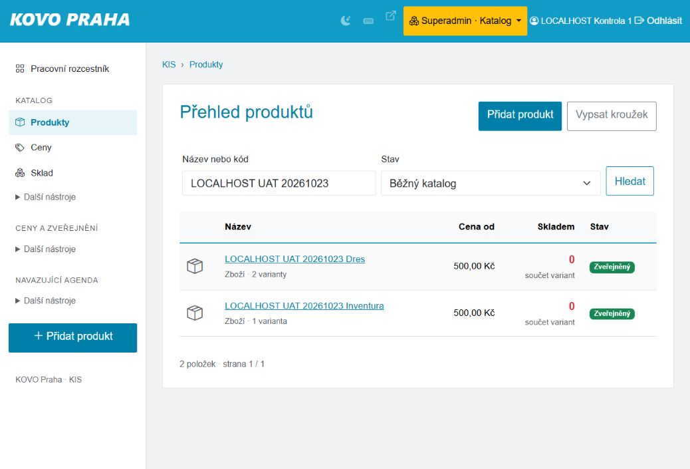

# Připravená místní data pro přejímku

23. 10. 2026. Pouze izolované `http://127.0.0.1:18086`, databáze `evidence_b1` na portu 33426. Před přípravou read-only probe ověřil identitu runtime, 326 čitelných tabulek, vypnuté vnější transporty a soukromé úložiště mimo webroot. Produkce se nezměnila.

## Co je skutečně založeno

| Předpoklad | Skutečné ID | Stav |
|---|---|---|
| LOCALHOST UAT 20261023 Dres | produkt 44 | Zveřejněný pouze v izolované kopii |
| Velikost M, KP-UAT20261023-M | varianta 50 | 500 Kč; aktivní; bez skladového počátku |
| Velikost L, KP-UAT20261023-L | varianta 51 | 500 Kč; aktivní; bez skladového počátku |
| LOCALHOST UAT 20261023 Inventura | produkt 45, varianta 52, KP-UAT20261023-I | 500 Kč; aktivní; bez skladového počátku |
| LOCALHOST UAT 20261023 – pouze simulace | účetní katalogová kategorie 91, kód 3/98 | Mapována pouze na produkty 44 a 45 |

Katalog ukazuje 0 kusů. Read-only kontrola výslovně potvrdila, že varianty 50–52 zatím nemají řádek `shop_stock_balances`, skladový pohyb ani objednávkovou položku. **F04 a F13 tedy stále musí lidé provést počáteční inventuru**, příprava tento krok nepředběhla. Do F04 zadejte M 10 fyzicky / 2 blokované a L 5 fyzicky / 0 blokovaných; do F13 variantu 52 otevřete pěti kusy podle zadání.

Založení proběhlo přes viditelné formuláře: Produkty → Přidat produkt; Varianty a ceny → Přidat varianty; Hospodář → Číselné řady a účetní kategorie → nová kategorie 3/98 → přiřazení konkrétních produktů; Katalog → Hlavní údaje → Zveřejnit produkt. Všechny důvody obsahují SIMULACE UAT20261023. SKU vyžaduje prefix KP-. Výchozí mapování ostatních produktů, historické VS, dokladové řady a jejich čítače se neměnily. Kategorie není reálné rozhodnutí účetní (D01/D02 zůstávají otevřené).

## Účty pro dvě různé osoby

Existující **LOCALHOST Kontrola 1, pracovník 326**, a **LOCALHOST Kontrola 2, pracovník 327**, jsou aktivní a mají všechny pracovní pozice včetně Hospodáře; oba jsou současně superadmini. Ověřeno read-only, žádná role ani heslo nebyly změněny.

Pro F15/F16 lze použít 326 jako podatele a konkrétního příjemce a 327 jako jiného schvalovatele. Samostatné přihlášení je nutné, přepnutí pozice jednoho účtu nezmění identitu. Vlastní schválení kontroluje ID podatele/příjemce i u superadmina. Toto **neprokazuje izolaci oprávnění běžného pracovníka**.

Hesla zůstávají pouze v soukromém `C:\Users\Marek\AppData\Local\EvidencePavelB1\finance-b1-20261022\local-review-access.json`; nejsou v dokumentu, screenshotu ani JSON příloze. Omezený třetí trenér není založen: pravidla CUA vyžadují předání člověku před zadáním nového hesla a samostatné potvrzení citlivého rozšíření přístupu. Požadavek se podle zadání odkládá; žádný existující účet nebyl resetován ani zbaven rolí.

## Co zůstává k přípravě

- Omezený účet trenéra bez superadmina pro negativní přístupovou přejímku.
- F14 navazuje na první objednávku Anny z UAT-P06: kurz 1 200 Kč a kapacita 1; nezakládat jiný kurz. F17 potřebuje nový samostatný 60minutový trénink postupem UAT-P10; nepoužít P11 opravený na 50 minut. ID doplní tester po příslušném kroku.
- Původní ID účetního přídělu pro F10/F12 získá obsluha z listu Parovani pracovního exportu po provedení předcházejících kroků; zatím tyto platby neexistují.
- F20 převzetí vyžaduje skutečnou kontrolu druhým člověkem; druhý účet sám o sobě není účetní převzetí.

**Příprava fixture není provedená uživatelská přejímka. Všechny lidské scénáře zůstávají NEPROVEDENO.** Žádná nová objednávka, platba, faktura, inventurní pohyb ani skutečný účetní souhlas touto přípravou nevznikly.
