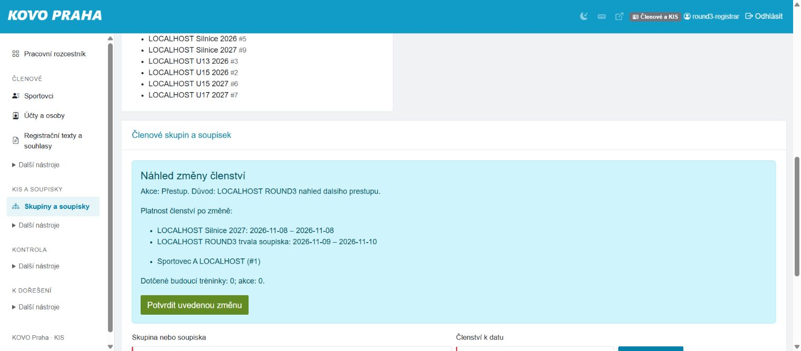
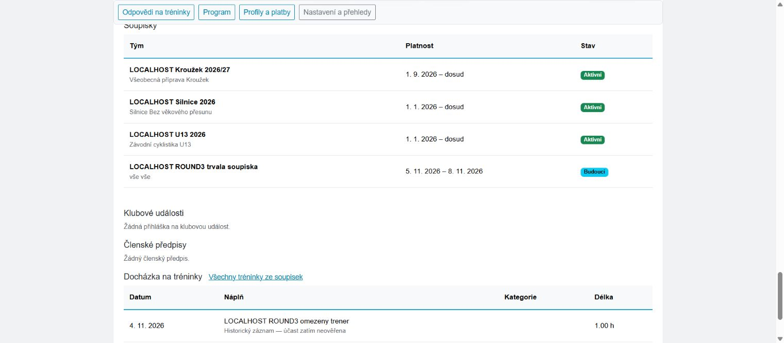

# Třetí autonomní funkční průchod — 4. 11. 2026

**119/119 kontrol pracovních přístupů PASS; dvě funkční chyby opravené místně.**
Skutečný Chrome ověřil přihlášenou produkční administraci a samostatné místní
účty trenéra, registráře a rodiče. Opravy tohoto průchodu nejsou nasazené.
Nejde o úplné lidské UAT ani o browser přejímku všech osmi omezených rolí.

Následné sloučení PR #293, produkční nasazení a ověření 4. 11. zachycuje
[samostatný protokol vydání](../functional-round3-release-20261104/RESULTS.md).
Výše uvedený stav nenasazení je původní snapshot před vydáním.

Výchozí main: `ef622b9924a73cb51419fa252b2bd4d1b83ea2fe`.
Větev: `codex/functional-uat-round3-20261104`. Časová zóna: Europe/Prague.
Vlastník povolil pokračovat v autonomním testování; dřívější pokyn zahrnuje opravy.
Změna hesla, skutečné opětovné použití obnovovacího odkazu a T07 jsou SKIPPED.

## Produkční browser kontrola

Původní přihlášená relace zůstala zachována. Účet je superadmin; přepnutí
pracovní agendy není důkaz omezení jeho oprávnění. Na produkci se ukládaly pouze
auditované změny aktivního pracovního kontextu. Žádné osoby, členství, tréninky,
objednávky, finanční záznamy ani přístupové granty se tímto průchodem neměnily.

| Oblast | Skutečné pozorování |
|---|---|
| Registrář | Oddělená navigace členů/KIS, osm skupin, žádná nezařazená soupiska. |
| Časová hierarchie | TEST skupina: dva členové dnes a 2. 11.; nula k 1. 11. Pilotní soupiska má dvě syntetické osoby s vlastním intervalem. |
| Mobilní správa | Šířka 390 px, stránka nepřetéká vodorovně; nabídka se otevře/zavře a umožní přepnout agendu. |
| Programy | 88 řádků nabídek, konkrétní období a prodejní okna; mobilní tabulka nepřetéká mimo stránku. Průvodce novým kroužkem se načte, nic nezveřejněno. |
| Klubové akce | Seznam a filtry fungují; hledání neexistujícího označení vrátí prázdný výsledek. |
| Velodrom | Čitelný prázdný seznam budoucích termínů a rezervací; zakládací a opakovací formulář dostupný. |
| Finance | Samostatná agenda, výběr trvalých skupin/soupisek v příspěvcích, platební důvody a potvrzení dostupné. Negativní hledání vrátí prázdný přehled. Žádná platba nepotvrzena. |
| Staré URL | `kis_rosters_admin.php` přesměruje přihlášeného registráře na novou správu; bez formuláře nové sezony nebo rolloveru. |

Po skončení byl obnoven původní kontext **Správce systému** a běžná šířka
prohlížeče. Browser relace vlastníka nebyla odhlášena.

## Izolované syntetické prostředí

Nová vlastní MariaDB 10.4.32 na `127.0.0.1:3321`, databáze `functional_round3`,
vlastní Apache na `127.0.0.1:18421`. Vstupem bylo prázdné verzované schéma,
migrace, syntetická CSV fixture a demo seed. Žádný produkční dump ani config.
Session a soukromé soubory jsou mimo webroot; webové mail/cURL transporty vypnuté.
Fio import/auto-confirm, SumUp a Stripe jsou false. Ostatní lokální instance nedotčené.

- [Matice GET](role-matrix.json): osm samostatných účtů, každý s jedinou pracovní
  pozicí a bez superadmina. Osm hlavních tras, 64/64 očekávaných HTTP 200/403.
- [Matice POST](role-post-matrix.json): všech 55 kombinací nepovolené role a
  agendy odmítnuto HTTP 403 i při přímém POST. Žádný z těchto požadavků neměl platný CSRF.
- Omezený trenér: ve formuláři jediná svěřená soupiska U13; našeptávač nabídne
  dvě svěřené osoby a vynechá nesvěřeného sportovce A. Uložen jediný trénink
  s oprávněným sportovcem B; cizí zdravotní podklad a správa členství odmítnuty.
- Registrář bez superadmina: vytvořil trvalou soupisku bez sezony a přes náhled
  zařadil dva syntetické sportovce na 5.–10. 11. Počty: 4. 11. nula,
  5. a 10. 11. dva, 11. 11. nula. Historické řádky zůstaly zobrazené.
- Přestup A od 8. 11. zachoval konec 10. 11. a zkrátil zdroj do 7. 11.;
  cílová soupiska k 8. 11. měla jednoho člena. Ukončení B k 8. 11. se uložilo
  podle náhledu. Zrušení budoucího intervalu před začátkem má stav `cancelled`.
- Rodinný účet: pouze vlastní schválené profily; přímý odkaz na cizí osobu
  odmítnut. Neuzavřený trénink je označen jako neověřený a nezvyšuje součet
  ověřené činnosti. Budoucí členství po opravě zobrazuje český stav.

## F05 — nesprávná platnost v náhledu změny členství

Přestup z intervalu 5.–10. 11. od 8. 11. přebíral pole posledního dne z jiného
tlačítka společného formuláře. Zobrazil **8. 11. – 4. 11.**, ačkoli zápis
zachovával původní konec 10. 11. Také ukončení ukazovalo nesouvisející začátek.

Náhled nyní čte skutečný interval členství a ukazuje platnost pro každou
dotčenou soupisku. Zrušení před začátkem výslovně uvádí, že členství nebude
platné. Doménové zápisy, fingerprint, autorizace a kontrola budoucích odpovědí
zůstaly zachované. Bez změny schématu nebo datového převodu.

Tři nové regresní testy pokrývají přestup s pevným/otevřeným koncem, zařazení,
ukončení a zrušení před začátkem; porovnávají náhled s uloženými intervaly.
Před opravou selhaly, po opravě prošly. Browser potvrdil stejné chování.

[Ukončení členství](membership-end-preview-fixed.jpg) ·
[Zrušení před začátkem](future-cancellation-preview-fixed.jpg)

## F06 — technický stav místo časové platnosti v rodinném přehledu

Řádek s naplánovaným ukončením ukazoval rodiči `removed`, přestože jeho
platnost začínala až následující den. Staré zobrazení zároveň neodvozovalo
barvu/stav z prvního a posledního dne členství.

Český popisek a barva nyní vycházejí z data v Europe/Prague: Budoucí, Aktivní,
Ukončeno nebo Zrušeno. Poslední den je včetně; zrušený interval se neaktivuje.
Jde pouze o prezentaci. Zdrojový status, autorizace a datové čtení se nemění.
Jedenáct datových scénářů ověřuje hranice a otevřené intervaly.

## Automatické ověření a meze

- Cílené PHPUnit: 30 testů / 228 assertions PASS.
- Lokální úplná sada: 1 971 testů / 38 341 assertions, bez selhání;
  tři unixové/symlink testy přeskočené na Windows. Rozhodující je Linux CI u PR.
- Syntaxe dotčených PHP, PSR-12, Composer validace a dokumentační kontrakt ověřeny.
- Strojové souhrny: [testy a prostředí](verification.json), matice výše.
- Přihlášený produkční browser nerozšiřuje oprávnění omezených trenérů/rodičů.
  Matice osmi rolí je místní HTTP kontrola; úplné browser UAT všech rolí zůstává otevřené.
- Heslo/T07, poslední importní synchronizace, E8 a účetní/lidská přejímka se tímto neuzavírají.

PR je určen k samostatné kontrole a následnému rozhodnutí o nasazení.
