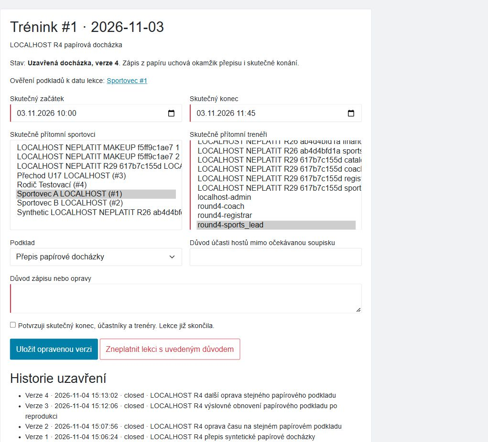

# Čtvrtý autonomní funkční průchod — 4. 11. 2026

**70 HTTP scénářů PASS; chyba původu papírové docházky reprodukována a opravena místně.**
Skutečný Chrome ověřil produkční zdravotní administraci a místní docházku;
samostatný Chromium dokončil místní opravu a průchod zdravotního podkladu do rodiny.
Změna není sloučená ani nasazená. Výchozí main `35a3985c40536575c807a8561d2436c03c9fcfe6`,
větev `codex/functional-uat-round4-20261104`, Europe/Prague.
Změna hesla, použitý obnovovací odkaz a T07 jsou dle vlastníka SKIPPED.

## Prostředí a hranice

Vlastní MariaDB 10.4.32 na `127.0.0.1:3322`, databáze `functional_round4`,
Apache na `127.0.0.1:18422`. Vstup: verzované prázdné schéma, migrace,
syntetická Shoptet CSV fixture a demo seed. Žádný produkční dump ani config.
Session a soukromé soubory mimo webroot; webové mail/cURL transporty zakázané.
Fio import/auto-confirm, SumUp a Stripe false. Původní WIP i ostatní instance nedotčené.
Vlastní omezené účty registráře a vedoucího sportu nemají superadmina.

Produkční Chrome otevřel zdravotní administraci jako registrář: prázdný přehled,
filtry a oddělené založení sledování/pravidel. Žádný produkční zdravotní, osobní,
sportovní ani finanční záznam se neměnil; přepnul se pouze pracovní kontext.
Chrome se během práce odpojil a nebyl dále dostupný. Návrat produkčního kontextu
ze registráře ke Správci systému se proto nedokládá. Místní práci dokončil jiný
prohlížeč. Dvě jeho karty sdílejí cookies; nejde o izolované relace ani o T07.

## F07 — oprava tiše mění původ papírové docházky

Ve skutečném formuláři vedoucí sportu uložil syntetický trénink #1 jako přepis
papírové docházky. Následný GET předvybral „Zápis trenéra“. Běžná oprava času
bez opětovného výběru podkladu proto uložila novou verzi se zdrojem `coach`.
Původní verze měla `paper`. Ztrácel se původ podkladu v nové verzi.

Formulář nyní přebírá zdroj z aktuálního kanonického snapshotu. Nový nebo starý
záznam bez údaje používá dosavadní výchozí `coach`; výslovná změna uživatele
v chybovém formuláři má přednost. Nový důvod, potvrzení a původní číslo verze
jsou stále povinné/zachované. Nemění se writer, historické verze, oprávnění ani schéma.
Povinný styl doplnil prázdný řádek a složené závorky u návratu; ostatní logika stejná.

Nový regresní test před opravou selhal (`paper` proti `coach`), po opravě PASS.
Šest případů pokrývá papír, nové/starší záznamy, neznámou hodnotu, výslovnou
změnu a zachování požadavku na nové schválení i zastaralé verze.
Browser a čtecí DB kontrola: verze 1 `paper` / 60 minut, chybná verze 2 `coach`
/ 90 minut, výslovná oprava 3 `paper` / 90 minut a běžná oprava 4 `paper` / 105 minut.
Původní verze zůstaly zachované. [Persistence](persistence.json), [browser](closure-browser.json).

## Další ověřené návaznosti

| Oblast | Důkaz a výsledek |
|---|---|
| Zdravotní evidence, 22 HTTP kontrol | Účel/sledování, multipart sken v soukromém úložišti, checksum downloadu, samostatné ověření, poslední den včetně, následující den expirovaný, zastaralá revize, osobní kontakt, rodinné zobrazení bez poznámek a okamžité odvolání přístupů. [Výsledky](medical-http.json). |
| Docházka a rozvrh, 25 HTTP kontrol | Platný CSRF i negativní CSRF, skutečné omezení rolí a měřených osob, potvrzení a konec lekce, verze, neměnný starý podklad/odměna, kontrolní případ, zákaz legacy smazání, zneplatnění, kolize přesunu, RSVP ochrana a historie náhradního termínu. [Výsledky](closure-http.json). |
| Náhrady, 23 HTTP kontrol | Osobní omluva zaplacené syntetické lekce; před uzavřením žádný nárok, po uzavření jeden nárok na osobu. Cizí rodič a CSRF odmítnuty, dvojí rezervace a plná kapacita bez dvojího čerpání, včasné storno vrací místo/nárok a ponechá historii, odvolaná vazba zablokuje starý formulář. [Výsledky](makeup-http.json). |
| Zdravotní browser | Registrář bez superadmina založil pro osobu 1 sledování #2 a papírový podklad #2 bez skenu. Rodina viděla čekání; po výslovném ověření platnost do 4. 11. včetně a úkol včas doložit navazující podklad. K 5. 11. stav expirovaný. Soukromé umístění originálu rodina neviděla. [Souhrn](medical-browser.json). |
| Rodinná činnost | Vlastní osoba 1 má po opravě jeden potvrzený trénink / 105 minut, původní syrová docházka se nepočítá navíc. [Detail](family-verified.txt), [snímek](family-medical-verified.png). |

HTTP scénáře používají existující verzované `tests/Support/MedicalClearanceHttpAcceptance.php`,
`TrainingClosureHttpAcceptance.php` a `MakeupJourneyHttpAcceptance.php` v dočasných
kopiích: změněna pouze explicitní identita vlastního sandboxu, cesty a porty,
ochrany prostředí ponechané. Vlastní syntetické identity mají platné serverové relace
a CSRF; nejde o extrakci browser cookies ani produkční relace.
Placené nároky jsou fixture podmínkou v vlastní DB, žádná skutečná platba.

## Validace a otevřené body

- Cílená sada po opravě **41 testů / 223 assertions PASS**; předchozí baseline 35/212 PASS.
- Úplná místní sada **1977 testů / 38360 assertions**, 0 chyb/selhání, tři známé
  Windows POSIX/symlink skipy. Běh trval 16:22 při paměťovém tlaku počítače.
- Syntaxe, changed-file PSR-12, rozpočet PHPStan baseline a dokumentační kontrakt ověřeny.
  Místní plná PHPStan analýza byla zastavena pouze u vlastních procesů kvůli nedostatku
  paměti; rozhodující plnou analýzu i Linux/MariaDB kontroly poskytuje CI navazujícího PR.
- [Strojový souhrn](verification.json). Běžné chybové logy negativních testů
  nepředstavují selhání celé sady. HTTP kontroly a browser se s počtem PHPUnit nesčítají.
- Úplné produkční UAT všech rolí, F06 štítky na propojeném produkčním účtu,
  poslední exportní synchronizace, E8 a lidská/účetní přejímka zůstávají otevřené.
  Heslo a T07 nejsou tímto průchodem uzavřené.

Oprava je určena k samostatné kontrole PR. Nové sloučení a produkční deploy v této vlně neproběhly.
