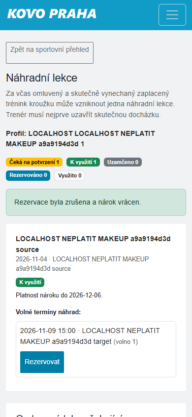

# Omluvenky a náhrady — kontrola 6. 11. 2026

**Funkčnost je již nasazená; kontrola neodhalila potřebu nové opravy ani nasazení.**
Kontrolovaný zdroj `89e73d5a570631a42a113f563011c49a37809a68`, Europe/Prague.
Omluvenky a náhrady byly obsažené už v předchozím vydání `436b1f85`;
porovnání `436b1f85..504fd69a` neobsahovalo změny jejich služeb ani stránky náhrad.
[Nasazení 504fd69a z 5. 11.](https://github.com/KovoPraha/evidenceTreninku/actions/runs/42019877235)
prošlo 2029 testy / 38953 assertions, zálohou, migracemi a HTTP kontrolou.
Mezi později nasazeným `76bf0370` a kontrolovaným zdrojem jsou
`includes/club_makeup.php`, `includes/training_rsvp.php`, `booking/nahrady.php`
a `booking/sportovni_prehled.php` shodné.
Existence starých pracovních větví není důkaz chybějícího nasazení.

## Výsledky

- `TrainingRsvpTest` a `ClubMakeupTest`: **22 testů / 139 assertions PASS**.
- [23 HTTP scénářů PASS](http-results.json): osobní omluva zaplacené lekce,
  žádný nárok před uzavřením docházky, jeden nárok po uzavření, rezervace,
  opakovaný požadavek bez dvojího čerpání, plná kapacita, včasné storno
  s vrácením místa a nároku a zachováním historie. Cizí rodič, neplatný CSRF
  a odvolaná vazba v existující relaci správně odmítnuty.
- Skutečný prohlížeč: běžné přihlášení syntetického rodiče, vlastní omluva
  budoucí lekce a zobrazení čekání na potvrzení docházky bez předčasného nároku.
  Následně rezervace již dostupného nároku z dříve uzavřené lekce a její zrušení.
  Nejde o tvrzení, že se budoucí lekce během testu odehrála.
- [Kontrola uložených dat po browser průchodu](browser-persistence.json):
  odpověď `not_going`, nárok po stornu `available`, jediná rezervace `cancelled`.
- Mobilní šířka 390 px: vizuálně ověřené čitelné stavy a dostupné tlačítko rezervace.

## Prostředí a hranice důkazu

Oddělená vlastní MariaDB 10.4.32 na `127.0.0.1:33436`, databáze
`makeup_uat_20261106`, web `127.0.0.1:18096`. Prázdné verzované schéma a migrace,
syntetické osoby a zaplacená účast jako fixture; žádný produkční dump ani platba.
Webové externí transporty a integrace vypnuté, session a soukromé soubory mimo webroot.
HTTP scénář používá kopii `tests/Support/MakeupJourneyHttpAcceptance.php`
s upravenou identitou vlastního sandboxu; ochrany cíle zůstaly zachované.
Pomocné služby a prohlížeč byly po kontrole ukončené.

Produkční anonymní otevření stránky náhrad správně přesměrovalo na přihlášení.
**Přihlášené produkční UAT omluvenky/rezervace se nyní neprovádělo.**
Veškeré zápisy patřily syntetické databázi. Produkční účty, hesla, data, platby
ani konfigurace se neměnily; T07 zůstalo vynechané. Bez změny runtime nebo schématu.
