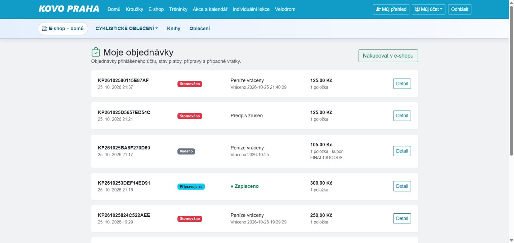
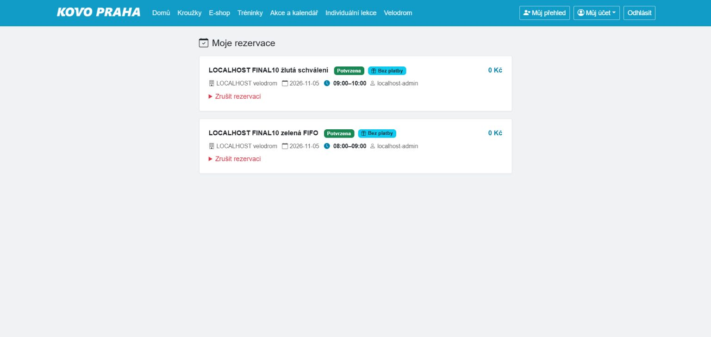
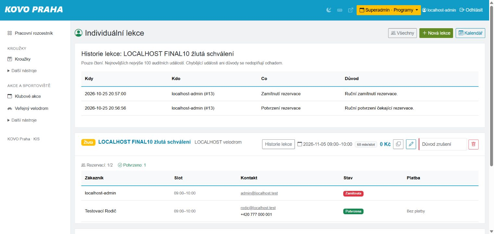

# Dokončení deseti částečných scénářů — 25. 10. 2026

**10 doplněných scénářů PASS; celkový stav A01–B30: 38 PASS, 2 BLOCKED (B04 a B23).** Navazuje na [předchozí přejímku](../remaining-acceptance-20261025/RESULTS.md). Výsledek se vztahuje k izolaci, nikoli k produkci. Dva blokované požadavky nejsou přepsány na splněné; konkrétní řešení uvádí [BLOCKERS.md](BLOCKERS.md).

## Provedené kroky a důkazy

### A10 — PASS

UI časová osa osoby #5 a nová historie lekce #14: aktér, čas, potvrzení i zamítnutí. Rodič vidí potvrzené lekce. Nová HTTP regrese ověřila escapování, cizího trenéra, vynucené vse=1 a čtení bez zápisu.

### B05 — PASS

UI dvojklik přejmenoval plán #34, skutečné drag&drop jej přesunulo z 24. na 23. října; zrušení celé série ukončilo #34–36. Kopie týdne #37–38 z předchozího UI průchodu zůstaly plánované. Databázová kontrola potvrdila přesný rozsah.

### B06 — PASS

UI založení interní rezervace 5.11. 06–07, zelené lekce #13 a žluté #14. Veřejné přihlášení, ruční potvrzení rodiče a zamítnutí druhé žádosti. Bezplatná lekce správně ukazuje Bez platby.

### B07 — PASS

Veřejný formulář obsadil zelený slot ihned; rodič se přidal na plnou čekací listinu. Zrušení aktivní rezervace přes dvoukrokový formulář povýšilo rodiče. Potvrzeno ve správě i Moje rezervace; více čekatelů a shodný čas kryje čerstvá HTTP regrese.

### B08 — PASS

Syntetické CSV: CLI dry-run a staging run #2 (import je záměrně nástroj, nikoli upload UI). V prohlížeči ruční klasifikace/schválení, převod do draftu, publikace produktu #42 a kontrola veřejné nabídky za 200 Kč. Účetní kategorie produktu byla testovací předpoklad přes kanonickou lokální funkci.

### B10 — PASS

UI neuhrazené storno #32; zaplacení, storno refund_required a potvrzení vratky #33 s bankovní referencí. Navíc #31: položkový výdej, fyzická vratka, posouzení prodejnosti, faktura #13, oprava #14, peněžní příjem #67, uvolnění přídělu, vratka #7 a uzavření případu #13. Rodič vidí obě platby vrácené. Sklad varianty #38: 4 fyzicky, 0 rezervováno, 0 blokováno; každé storno má právě jedno uvolnění.

### B11 — PASS

UI kupón FINAL10GOODS: pouze zboží, minimum 100 Kč, sleva 20 Kč. Samotný kurz i akce odmítnuty, zboží 125 Kč vytvořilo objednávku #31 s neměnnou slevou 20 Kč a celkem 105 Kč.

### B16 — PASS

UI placená akce #20 s termínem, souhlasem, storno podmínkami a soupiskami #18 a #20. Způsobilé dítě A nabízeno, B vyloučeno. Objednávka #30 za 300 Kč, potvrzená úhrada a přihláška. CSV skutečně stažené prohlížečem: kontrakt m2.event-participants.v1, 1 confirmed, souhlas a obě soupisky. Dvojí stažení na stejné stránce po opravě funguje.

### B24 — PASS

CLI vytvoření syntetického preview #1; UI ověření fingerprintu, aplikace dvou záznamů do sandboxu a rollback 2 → 0. Otisky osob, soupisek, objednávek a předpisů před/po jsou stejné. Kanonický import ani produkce nebyly zapnuty.

### B30 — PASS

Samostatný běžný trenér má vlastní nástroje bez správy účtů a financí; správce prošel aktuálními pracovními pozicemi. Zkratky N/P/K/?, Esc a D ověřeny skutečnými stisky, světlý režim obnoven. Odkaz veřejného portálu otevřel správnou novou kartu. Rodičovské menu ověřeno při dočasném výpadku Bootstrap i app-ui JS; oba soubory obnoveny. Nápověda již nenabízí neexistující globální hledání.

## Opravy z přejímky

- Rodič nyní vidí skutečně vyplacené účetní vratky i u již vydané objednávky. Částečná vratka má samostatný popisek a částku; rozhodnutí bez výplaty se za vrácené peníze nepovažuje. Jde o čtecí zobrazení po autorizaci přístupu k objednávce. Původní payment.status, objednávka, cena ani historie se nepřepisují.
- Historie lekce zobrazuje nejnovějších nejvýše 100 událostí, čas, aktéra a důvod. Respektuje stejný rozsah lekcí jako seznam, nevypisuje interní JSON a sama nic nezapisuje.
- Zamítnuté přejmenování plánu nyní oznámí důvod; síťová chyba vyzve k ověření uloženého stavu.
- Zrušení rezervace používá potvrzovací formulář na stránce s CSRF. Ověřeno skutečné zrušení a povýšení čekatele.
- Bezplatné lekce nezobrazují zavádějící nezaplacený stav.
- Menu Můj účet funguje nativním HTML i při výpadku JS; veřejný desktopový pohled ověřen skutečným dočasným nahrazením obou místních JS souborů prázdným obsahem. Soubory byly následně obnoveny. To není tvrzení, že všechny části aplikace fungují bez JS nebo že byla provedena celá mobilní přejímka.
- Export účastníků neuzamkne stránku po odpovědi se souborem. Běžné zápisové POST formuláře si zachovávají ochranu proti dvojímu odeslání.
- Pokyny pro již připojené účetní doklady vysvětlují, kdy ponechat ID prázdná. Výběr bankovního účtu/pokladny rozlišuje druh účtu. Odstraněn neaktuální text o neexistujícím storefrontu a nedostupná zkratka hledání z nápovědy.

## Ověření a provozní hranice

Úplná lokální sada: **1 723 testů, 34 914 assertions, 0 chyb, 0 selhání, 3 unixové testy přeskočené na Windows**. JavaScript: **14/14**. Čerstvá HTTP/MariaDB regrese: **34 + 7 kontrol**. Unixové testy a MariaDB 10.3/11.4 musí projít na přesném headu PR před sloučením. Kontrolní stav a počty jsou v [validation.json](validation.json); finální CI a merge jsou doloženy PR.

Použit samostatný checkout evidencePavel-browser-acceptance-20261025, web 127.0.0.1:18096, MariaDB 127.0.0.1:33436, evidence_b1. Readiness potvrdila 327 tabulek, soukromá data mimo webroot a vypnuté externí transporty. Žádná skutečná platba, zpráva, import skutečných osob ani změna produkce. Nové integrace nejsou aktivované. Původní pracovní adresář a jeho nesouvisející WIP zůstaly zachovány.

Ponechané syntetické doklady, objednávky, lekce a audit slouží jako opakovatelná ukázka. Košík je prázdný; skladové rezervace testovaných objednávek jsou uvolněné, vratka uzavřená. KIS sandbox byl vrácen zpět. Automatizované HTTP sady navíc zakládají vlastní náhodně označené syntetické fixture.

## Další doporučení pro UX (neblokují ověřené scénáře)

- V kalendáři sportovišť sbalit dlouhou legendu trenérů; v testovací databázi stovky fixture zbytečně odsouvají kalendář.
- Pro vratky nabídnout výběr dokladů podle objednávky místo ručního opisování čísel ID.
- U výběru příjmu doplnit čitelný kód objednávky, aby účetní nemusela přecházet mezi evidencemi.

## Ukázky

