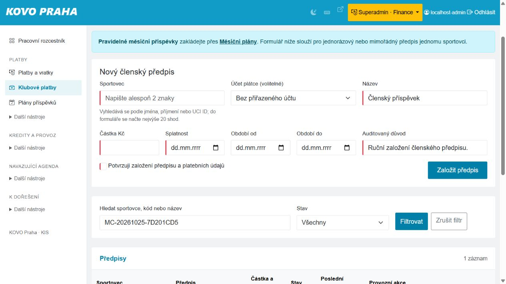
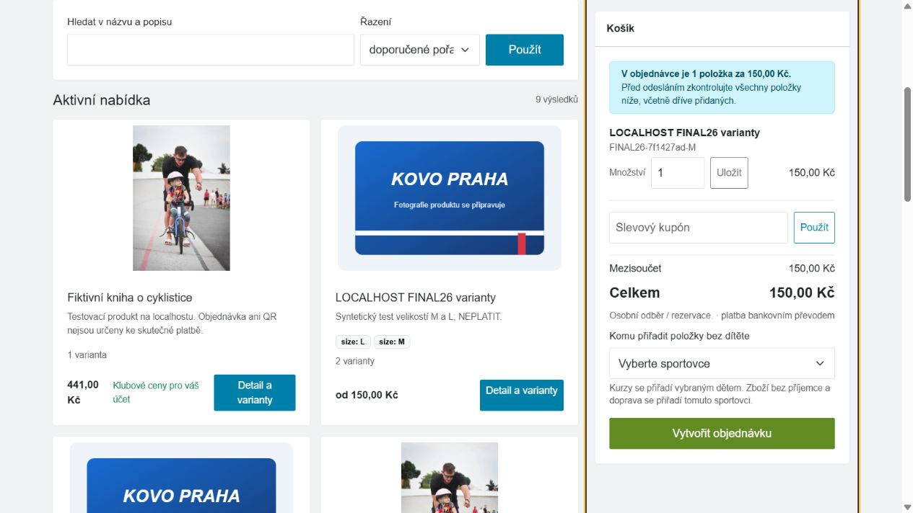
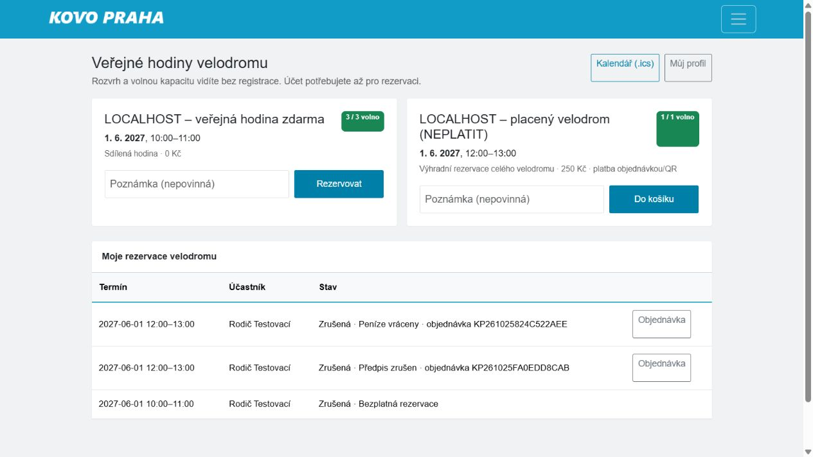

# Zbývající přejímka A/B — 25. 10. 2026

Aktualizace: následný [průchod deseti částečných scénářů prohlížečem](../partial-browser-acceptance-20261025/RESULTS.md) je dokončil. Tento dokument zachovává původní historický stav; aktuálně 38 PASS a 2 BLOCKED.

Rozsah: 20 dosud neověřených a 6 částečných scénářů; pouze izolované prostředí. Opravy jsou připravené ve [společném PR #203](https://github.com/KovoPraha/evidenceTreninku/pull/203). Nasazení ani produkční zápisy nejsou součástí této práce. Stav sloučení a CI určuje PR, nikoli tento předběžný dokument.

**Výsledek těchto 26 scénářů: 14 PASS, 10 PARTIAL, 2 BLOCKED.** Každý scénář byl technicky prověřen; není to tvrzení o dokončené klikací přejímce celého systému. PASS může kombinovat prohlížeč, skutečné HTTP formuláře a integrační testy; metody i omezení jsou uvedeny jednotlivě. Zelená automatizace nenahrazuje chybějící UI důkaz.

Dvě věcné překážky zůstávají: B04 nemá hotové kanonické zadávání interních/externích závodních výsledků podle původního scénáře; B23 požaduje již odstavený přímý zápis starým importérem. Starý import nebyl znovu povolen. Zbývajících deset PARTIAL má funkční automatizované pokrytí, ale nemá úplný nový průchod všemi kroky původního UI scénáře.

## Opravené problémy

- Čekací listina používá stejný zámek pro HH:MM a HH:MM:SS, stabilní pořadí při shodném čase a nepovyšuje čekatele ze zrušené lekce. Ruční potvrzení čekatele nemůže obejít kapacitu. Potvrzení a zamítnutí mají atomický audit s oznámením ve frontě.
- Klubová cena je shodná na kartě katalogu, detailu, v košíku a objednávce. V testu rodič 441 Kč, anonym 490 Kč.
- Roční přehled zahrnuje zboží přiřazené finančnímu profilu objednávky; explicitní příjemce položky má přednost. Cizí a odvolané vazby zůstávají chráněné.
- Rezervace velodromu ukazuje kanonický stav vratky objednávky, ne historický příznak zaplacení. Rodičovská tabulka plateb používá české popisky včetně vratek.
- Tréninky počítají kanonická měření, výkazy mají funkční měsíční CSV, popisek vzdálenosti odpovídá přepínači m/km. Neuchovávané volné pole cviku je nahrazeno instrukcí pro ukládanou poznámku měření.
- Vedoucí sportu má přístup k načítání podskupin závodu. Plánovač po přesunu aktualizuje počty a prázdné stavy obou dnů.
- Hospodář má nový čtecí odkaz **Historie předpisu** s časem, aktérem, změnou stavu a důvodem; bez odhalení celých datových snapshotů a bez zápisu při načtení. Registrář přístup nemá. Nejnovějších nejvýše 100 událostí je výslovně označeno.
- Odkazy přejímky vedou na výběr položky místo neplatných adres bez ID nebo soukromého tokenu. Původní nesplněné požadavky scénářů nebyly přepsány na PASS.

## Ověření

- Úplná PHPUnit sada v izolaci; výsledek a přesné počty jsou v `validation.json`.
- 10 JavaScript kontrol: plánovač, editace tréninku a klávesnicové našeptávání.
- 26 čerstvých sad MariaDB/HTTP: **821 kontrol**, viz `http-summary.json`.
- Další chráněná sada `tests/Support/RemainingScenarioHttpAcceptance.php`: **34 kontrol**, viz `remaining-http.json`. Celkem tedy **855 kontrol HTTP sad**; počet není počtem nezávislých uživatelských scénářů.
- Skutečné stažení XLSX a CSV výkazů: 1,5 + 1 = 2,5 h. Soukromý ICS skutečně stažen prohlížečem, veřejný ICS přes localhost HTTP; nezávislý parser icalendar 6.3.2 přijal 9 a 7 událostí.
- Linux CI ověřuje i tři unixové symlinkové kontroly, které Windows přeskakuje; současně MariaDB 10.3 a 11.4. Finální přesný commit musí mít zelené CI před sloučením.
- Čerstvá kontrola izolace PASS: 327 dostupných požadovaných tabulek, soukromé cesty mimo webroot, externí transporty vypnuté (`readiness.json`).

## Výsledky jednotlivých scénářů

| Scénář | Stav | Provedeno | Zbývá / hranice důkazu |
|---|---|---|---|
| A09 | PASS | Nový skutečný HTTP průchod: registrace s datem narození, právě jeden vlastní profil, šifrovaná ověřovací zpráva v místním outboxu a ověření účtu. Volné i placené rezervace ověřeny UI/HTTP a integračně. | Registrace přes HTTP; bez skutečného odeslání e-mailu. |
| A10 | PARTIAL | Časová osa osob a rezervační audit. Nový HTTP test ověřil aktéra, čas/důvod a jedinou událost při opakovaném potvrzení. | Samostatný úplný UI průchod rezervační historií rodiče zbývá. |
| B01 | PASS | UI trénink #21: 400 m, 2 km, časy, 20 kg × 8 a RPE 8; RPE 0/11 a neplatný čas odmítnuty; znovu otevřeno. | — |
| B03 | PASS | UI výkazy 1,5 + 1 = 2,5 h; XLSX a CSV skutečně staženy a otevřeny. Počet kanonických měření opraven na 3. | — |
| B04 | BLOCKED | UI závod #1 s kategorií, URL a měřením; úprava zachovala měření. Opraven HTTP 403 načtení podskupin. | Formulář neumožňuje zadat interní a externí výsledky podle scénáře. Starý import je záměrně odstaven; nová kanonická editace externích výsledků není implementována. |
| B05 | PARTIAL | UI série se dvěma soupiskami, přesun tlačítkem a kopie týdne. Nový HTTP test ověřil rename, move, ochranu rezervovaného sportoviště, kopii bez rezervací a zrušení série. JS regrese ověřila aktualizaci počtů dnů. | Skutečné gesto drag&drop a inline dvojklik nebyly prokázány automatizací prohlížeče; endpointy fungují. |
| B06 | PARTIAL | Nový MariaDB/HTTP test: rezervovaná kapacita, ruční potvrzení, odmítnutí, fronta a audit; podvržené potvrzení čekatele kapacitu neobejde. | Kompletní UI založení interní rezervace a žluté/zelené lekce zbývá. |
| B07 | PARTIAL | Nový MariaDB/HTTP test: FIFO při shodném čase, jedno povýšení, plná kapacita, sjednocený zámek HH:MM/HH:MM:SS a zákaz povýšení zrušené lekce. | Zápis všech kroků veřejným rezervačním formulářem nebyl proveden. |
| B08 | PARTIAL | Syntetický Shoptet vstup, staging, review, promote, draft/publish, idempotence a oddělení veřejného katalogu. | Celý importní průchod není nový UI důkaz. |
| B09 | PASS | UI objednávka #28 za 441 Kč s QR; izolované HTTP potvrdilo platbu opakovaně, ready a completed; UI ukázalo Vydáno/Zaplaceno. Sledované sklady navíc prošly HTTP sadou výdejů. | Administrační přechody byly provedeny HTTP, ne klikáním. |
| B10 | PARTIAL | Čerstvé transakční a HTTP testy neuhrazeného storna, uhrazeného storna, výdeje, vratek, korekcí a referencí hospodáře. Dřívější UI ověřilo vratku kurzu. | Úplný nový UI průchod vratkou fyzického zboží zbývá. |
| B11 | PARTIAL | Výchozí goods scope, minimum, limit použití, expirace, oddělení zboží/služeb a neměnné slevové snapshoty. | Není nový UI průchod formulářem kupónů. |
| B12 | PASS | Opravena karta katalogu. UI i nový HTTP test rodič 441 Kč versus anonym 490 Kč; košík a snapshot objednávky 441 Kč. | Pozdější změny pravidla a revokace pokrývají integrační testy. |
| B13 | PASS | UI produkt #40: viditelné L/175 Kč a M/150 Kč, skrytá třetí varianta nenabízena, přepnutí na M a košík se správným SKU/150 Kč. Košík následně vyprázdněn. Bezpečnost MIME/EXIF, lokálních obrázků a publikace kryjí integrační testy. | Localhost běží na HTTP; produkční HTTPS nebylo v tomto průchodu testováno. Syntetický produkt používá prázdný obrázek. |
| B16 | PARTIAL | Více cílových soupisek, způsobilost účastníků, snapshoty a placené události. | Úplný nový UI průchod placenou akcí a stažením CSV zbývá. |
| B17 | PASS | UI objednávka #29/250 Kč; dvojí potvrzení přes izolované HTTP; UI právě jedna Potvrzená/Zaplaceno a 0/1 volno. Po stornu/vratce opět 1/1 volno. Opraven štítek vrácené platby. Po opravě potvrzeno UI „Zrušená · Peníze vráceny“. | Administrační platba a vratka byly provedeny HTTP. |
| B18 | PASS | Nový HTTP průchod registrace, generické odpovědi při duplicitním e-mailu, ověření tokenu, žádosti o dítě, schválení registrářem a zobrazení vazby žadateli. | Syntetický e-mail z místní šifrované fronty; bez externí doručitelnosti. |
| B19 | PASS | Nový HTTP průchod resetu hesla vlastního syntetického účtu, okamžité zneplatnění původní relace a odmítnutí již použitého tokenu. Dětský reset a odvolané vazby navíc integračními testy. | Obnova přes HTTP; heslo skutečného uživatele ani produkce se neměnilo. |
| B20 | PASS | UI vygenerovalo soukromý ICS a soubor byl skutečně stažen. Nezávislý parser icalendar 6.3.2 přijal 9 událostí; unikátní UID a platné termíny. Čerstvé integrační testy rotace/revokace a 30denní agendy. | Přejímka v izolaci; odběr v externím telefonu/Google/Apple kalendáři nebyl zapnut. |
| B21 | PASS | UI roční přehled po opravě 441 Kč přiřazených dítěti A; vrácené a neuhrazené položky chybí. Nová regrese fallback finančního profilu, cizí položky a revokace; oddělení CZK/EUR. | Opt-in/out a náhled již byly ověřeny dříve; v tomto průchodu doplněny placené položky. |
| B22 | PASS | Veřejný ICS načten přes localhost HTTP a zpracován nezávislým parserem: 7 událostí, unikátní UID, platné termíny, bez jmen testovacích dětí/e-mailu. Integrační testy soukromí. | Přejímka souboru v izolaci; externí odběr záměrně nezapnut. |
| B23 | BLOCKED | Ověřeny preview/fingerprint a bezpečnost importních kontraktů. | Původní čtvrtý krok přímého zápisu v sync_evidence.php byl bezpečnostně vyřazen. Aktuální UI předává do KIS centra. Původní scénář nelze označit PASS ani přímý zápis znovu povolit. |
| B24 | PARTIAL | Skutečné izolované promote/rollback/reapply, idempotence, drift preview, audit, atomický rollback a nezměněná kanonická data. | Není nový úplný UI průchod KIS centrem. |
| B25 | PASS | UI rodiče, omezeného sportovce a hospodáře ukázalo tentýž LOCAL-REMINDER-001 / 1 250 Kč. Doplněna chybějící historie předpisu: UI vlastního předpisu #9 ukázalo založení a zrušení s aktérem, časem a důvodem. HTTP ověřilo escapování, čtení bez zápisu a zákaz přístupu registráře. | Historie předpisu je pro hospodáře; starší importované záznamy mohou být bez auditních událostí. Výpis je omezen na nejnovějších 100 událostí. |
| B28 | PASS | Nový HTTP test odebral pracovní pozici vlastního syntetického trenéra; stejná session ihned 403. Deaktivace ukončila přístup, testovací nastavení vráceno. | Provedeno HTTP, bez změn produkčních přístupů. |
| B30 | PARTIAL | Čerstvé testy registru pozic, sdíleného shellu a navigace. UI rodiče, sportovce a správce odpovídalo pozici; přepnutí na hospodáře zpřístupnilo finanční agendu. Tmavý/světlý režim a dialog nápovědy fungují, světlý režim obnoven. | Skutečné stisky všech klávesových zkratek a všechny role bez JavaScriptu nejsou doloženy; ovládací rozhraní nepřijalo klávesovou akci. |

## Prostředí, opakovatelnost a testovací data

Vlastní checkout `evidencePavel-browser-acceptance-20261025`, web `http://127.0.0.1:18096`, MariaDB `127.0.0.1:33436`, schémata `evidence_b1*`. Žádná produkční kopie osob ani změna produkčních hesel. Současná sada RemainingScenarioHttpAcceptance vyžaduje přesný checkout z owner.txt, datový adresář, porty a descriptor synthetic_only/external_sends_disabled; nemá režim pro produkci.

Registraci zpočátku správně zastavila chybějící místní konfigurace citlivých údajů. Pouze pro toto prostředí vznikl nový náhodný testovací keyring a oddělený indexový klíč v runtime/private/local-sensitive-keys.php mimo webroot. Ignorovaný místní config.php je načítá. Klíče nejsou součástí commitu ani logů a neotáčejí produkční klíče. Při přípravě nového sandboxu musí mít registrace platné PERSON_RC_KEYRING, PERSON_RC_ACTIVE_KEY_VERSION a PERSON_RC_INDEX_KEY; obecný původní setup je sám neprovisionuje. E-mailové ověření čte jen vlastní syntetickou šifrovanou zprávu; žádný mail worker se nespouští.

Výsledky obsahují pouze syntetické identifikátory. Košík variant byl po kontrole vyprázdněn. Placená velodromová rezervace byla kanonicky stornována a vrácena, členský předpis nové HTTP sady zrušen. V izolaci jsou úmyslně ponechané ukázky tréninku #21, závodu #1, série #34–38, zboží #40, vydané objednávky #28 a jejich auditní historie pro opakovanou kontrolu. Nejde o úklid produkčních dat ani o tvrzení, že testovací databáze je prázdná. Soukromý kalendář je pouze syntetický, externí odběr nebyl připojen.

Původní hlavní pracovní adresář a jeho nesouvisející rozpracované změny nebyly resetovány. Produkční workflow je ruční workflow_dispatch; tento balík ho nespouští. Sloučení do main samo není nasazením.

## Doklady z prohlížeče

